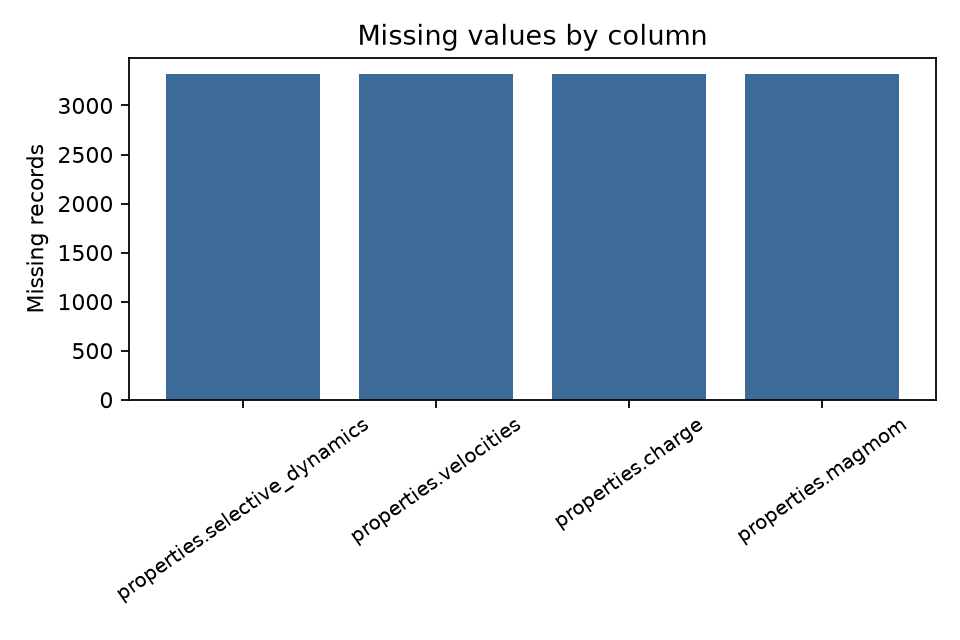
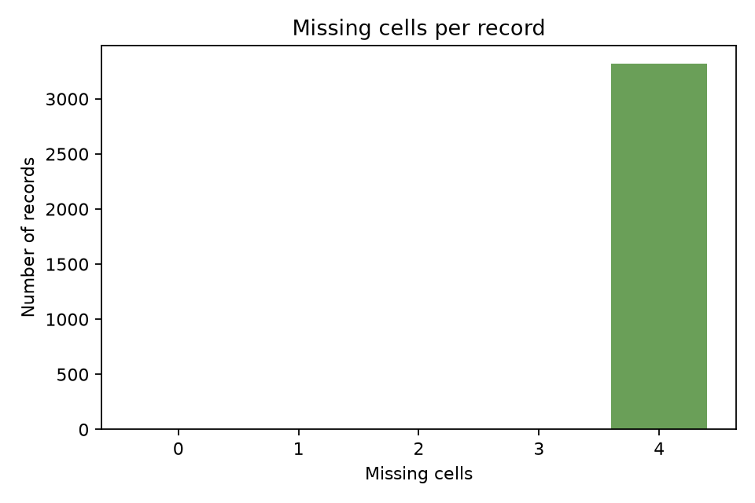
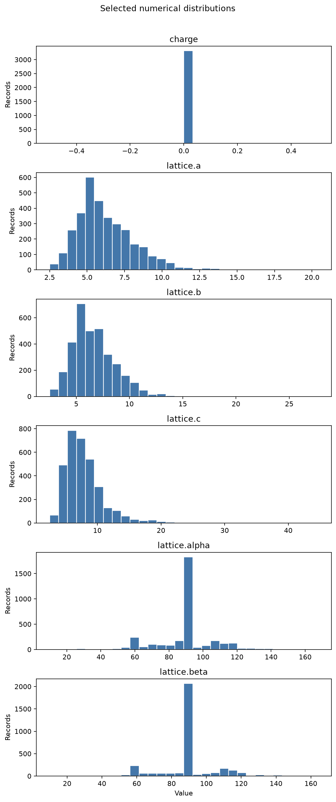
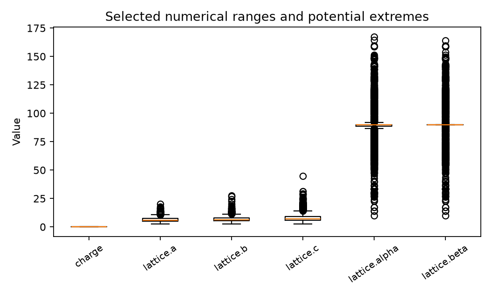
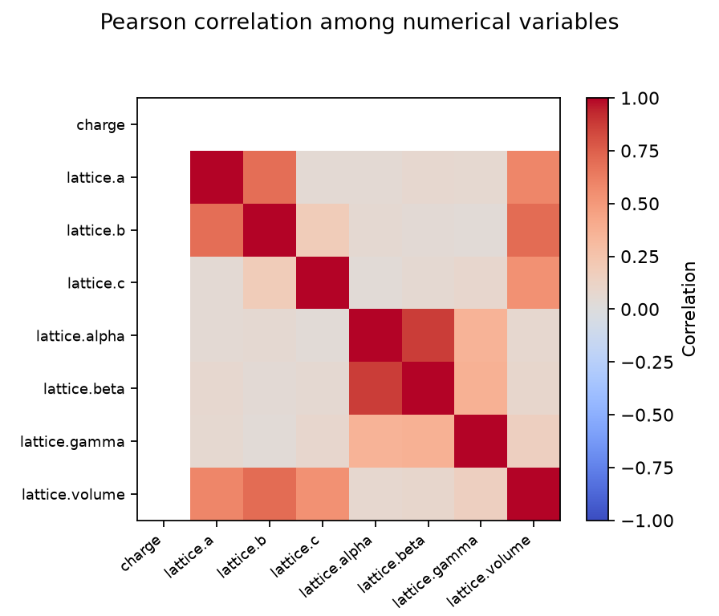

# Data Inspection Report

*Researcher-centric investigation of materials_piezoelectric_structures.json*

## Overview

This JSON dataset contains **3,317 records** across **18 variables** (4 empty, 8 number, 6 string). It uses 50,181,177 bytes (47.8565 MiB) on disk and about 24,249,128 bytes (23.1258 MiB) in the profiled DataFrame.

| First-page summary | Evidence |
| --- | --- |
| Overall completeness | 77.7778% (13,268 missing cells across 4 variables) |
| Exact duplicate records | 0 additional occurrence(s) beyond the first |
| Identifier-like variables | 3 |
| Review findings | 20 |

| Metric | Value |
| --- | --- |
| Source file | materials_piezoelectric_structures.json |
| Source path | /Users/tanweerulhaque/Desktop/NTU/Astar_opportunity/ds_first/JobMatchAssessment/OptionB_ExampleDatasets/materials_piezoelectric_structures.json |
| Extension | .json |
| Format | JSON |
| File size | 50,181,177 bytes (47.8565 MiB) |
| Rows | 3,317 |
| Columns | 18 |
| Estimated in-memory size | 24,249,128 bytes (23.1258 MiB) |

### Priority observations

- **All-null column** in **properties.charge**: No non-missing values were observed.
- **All-null column** in **properties.magmom**: No non-missing values were observed.
- **All-null column** in **properties.selective_dynamics**: No non-missing values were observed.
- **All-null column** in **properties.velocities**: No non-missing values were observed.
- **Constant numeric column** in **charge**: All finite numeric values are identical.

Initial assessment: the source was profiled without changing values. These are investigation prompts, not automatic corrections or scientific validation.

## Overall summary

- Missing cells: 13,268 across 4 column(s).
- Additional duplicate rows: 0.
- Potential quality findings: 20.
- Findings by severity: info: 8, warning: 12.

## Schema inventory

### Chapter 1: Understanding what is in the dataset

The schema comprises 4 empty, 8 number, 6 string. 3 variable(s) are identifier-like and are not interpreted as measurements. Observed scalar types show the evidence used for inference.

| Column | Non-null | Inferred semantic type | Observed types (count) | Likely identifier |
| --- | --- | --- | --- | --- |
| \_key | 3,317 | string | string: 3,317 | Yes |
| @module | 3,317 | string | string: 3,317 | No |
| @class | 3,317 | string | string: 3,317 | No |
| charge | 3,317 | number | number: 3,317 | No |
| lattice.matrix | 3,317 | string | string: 3,317 | Yes |
| lattice.pbc | 3,317 | string | string: 3,317 | No |
| lattice.a | 3,317 | number | number: 3,317 | No |
| lattice.b | 3,317 | number | number: 3,317 | No |
| lattice.c | 3,317 | number | number: 3,317 | No |
| lattice.alpha | 3,317 | number | number: 3,317 | No |
| lattice.beta | 3,317 | number | number: 3,317 | No |
| lattice.gamma | 3,317 | number | number: 3,317 | No |
| lattice.volume | 3,317 | number | number: 3,317 | No |
| properties.magmom | 0 | empty | N/A | No |
| properties.charge | 0 | empty | N/A | No |
| properties.velocities | 0 | empty | N/A | No |
| properties.selective_dynamics | 0 | empty | N/A | No |
| sites | 3,317 | string | string: 3,317 | Yes |

| Variable | Type | Non-null | Distinct | Note |
| --- | --- | --- | --- | --- |
| \_key | string | 3,317 | 3,317 | Identifier-like |
| @module | string | 3,317 | 1 |  |
| @class | string | 3,317 | 1 |  |
| charge | number | 3,317 | 1 |  |
| lattice.matrix | string | 3,317 | 3,317 | Identifier-like |
| lattice.pbc | string | 3,317 | 1 |  |
| lattice.a | number | 3,317 | 3,317 |  |
| lattice.b | number | 3,317 | 3,317 |  |
| lattice.c | number | 3,317 | 3,317 |  |
| lattice.alpha | number | 3,317 | 1,803 |  |
| lattice.beta | number | 3,317 | 1,576 |  |
| lattice.gamma | number | 3,317 | 2,147 |  |
| lattice.volume | number | 3,317 | 3,317 |  |
| properties.magmom | empty | 0 | 0 | All missing |
| properties.charge | empty | 0 | 0 | All missing |
| properties.velocities | empty | 0 | 0 | All missing |
| properties.selective_dynamics | empty | 0 | 0 | All missing |
| sites | string | 3,317 | 3,317 | Identifier-like |

## Missing values

### Chapter 2: Can I rely on the completeness of this data?

Overall completeness is **77.7778%**. Missingness affects 4 variable(s). High missingness means at least 5% missing.

Most affected variables: **properties.magmom** 3,317 (100%); **properties.charge** 3,317 (100%); **properties.velocities** 3,317 (100%); **properties.selective_dynamics** 3,317 (100%).

| Column | Missing | Missing % | Non-null | High missingness |
| --- | --- | --- | --- | --- |
| \_key | 0 | 0% | 3,317 | No |
| @module | 0 | 0% | 3,317 | No |
| @class | 0 | 0% | 3,317 | No |
| charge | 0 | 0% | 3,317 | No |
| lattice.matrix | 0 | 0% | 3,317 | No |
| lattice.pbc | 0 | 0% | 3,317 | No |
| lattice.a | 0 | 0% | 3,317 | No |
| lattice.b | 0 | 0% | 3,317 | No |
| lattice.c | 0 | 0% | 3,317 | No |
| lattice.alpha | 0 | 0% | 3,317 | No |
| lattice.beta | 0 | 0% | 3,317 | No |
| lattice.gamma | 0 | 0% | 3,317 | No |
| lattice.volume | 0 | 0% | 3,317 | No |
| properties.magmom | 3,317 | 100% | 0 | Yes |
| properties.charge | 3,317 | 100% | 0 | Yes |
| properties.velocities | 3,317 | 100% | 0 | Yes |
| properties.selective_dynamics | 3,317 | 100% | 0 | Yes |
| sites | 0 | 0% | 3,317 | No |

Row burden: 3,317 of 3,317 record(s) have at least one missing cell; the worst record misses 4 of 18 fields.

#### Most common missing-value patterns

Each pattern is the exact set of fields missing together in a record.

| Missing together | Records | Share of records |
| --- | --- | --- |
| properties.magmom, properties.charge, properties.velocities, properties.selective_dynamics | 3,317 | 100% |

The most common pair of absent fields is **properties.magmom** and **properties.charge** (3,317 records); review their shared collection path.

#### Fields missing in the same records

| Field A | Field B | Records missing both |
| --- | --- | --- |
| properties.magmom | properties.charge | 3,317 |
| properties.magmom | properties.velocities | 3,317 |
| properties.magmom | properties.selective_dynamics | 3,317 |
| properties.charge | properties.velocities | 3,317 |
| properties.charge | properties.selective_dynamics | 3,317 |

*Columns ranked by the number of missing records.*

*Distribution of missing-cell burden across records.*

## Duplicate rows

The count is additional full-row occurrences beyond the first occurrence in each group after missing-value normalization; for example, three identical rows contribute two additional rows.

| Metric | Value |
| --- | --- |
| Additional duplicate rows | 0 |
| Share of all rows | 0% |

## Numeric summaries

### Chapter 3: What do the measurements tell us?

Finite numeric values are summarized with linear quartiles and sample standard deviation (ddof=1). Mixed columns describe their numeric subset only.

- **lattice.volume**: range 11.9186 to 3998.47, median 250.628, skewness 3.16419.
- **lattice.c**: range 2.50171 to 44.6635, median 7.27667, skewness 2.33945.
- **lattice.b**: range 2.50223 to 27.6978, median 6.34375, skewness 1.71701.
- **lattice.a**: range 2.50223 to 20.397, median 5.85185, skewness 1.21373.
- **charge**: range 0 to 0, median 0, skewness 0. Zeros: 100%.

*Histograms for selected numerical measurements; interpret scales separately.*

*Selected numerical ranges; points beyond whiskers are distributional candidates, not errors.*

| Column | Finite count | Nonfinite excluded | Minimum | Maximum | Mean | Median | Sample std (ddof=1) | Q1 (25%) | Q3 (75%) | Mode | Zero share | Scope / notes |
| --- | --- | --- | --- | --- | --- | --- | --- | --- | --- | --- | --- | --- |
| charge | 3,317 | 0 | 0 | 0 | 0 | 0 | 0 | 0 | 0 | 0 | 100% | Finite numeric values |
| lattice.a | 3,317 | 0 | 2.50223 | 20.397 | 6.25073 | 5.85185 | 1.93591 | 4.95956 | 7.31417 | 2.50223 | 0% | Finite numeric values |
| lattice.b | 3,317 | 0 | 2.50223 | 27.6978 | 6.69093 | 6.34375 | 2.12355 | 5.30269 | 7.7625 | 2.50223 | 0% | Finite numeric values |
| lattice.c | 3,317 | 0 | 2.50171 | 44.6635 | 7.92598 | 7.27667 | 3.27807 | 5.75465 | 9.1398 | 2.50171 | 0% | Finite numeric values |
| lattice.alpha | 3,317 | 0 | 9.97289 | 167.485 | 89.2838 | 90 | 17.457 | 88.5768 | 90 | 90 | 0% | Finite numeric values |
| lattice.beta | 3,317 | 0 | 9.97289 | 164.064 | 89.6892 | 90 | 16.786 | 89.9999 | 90 | 90 | 0% | Finite numeric values |
| lattice.gamma | 3,317 | 0 | 9.97289 | 163.181 | 93.0855 | 90 | 22.4081 | 90 | 109.56 | 90 | 0% | Finite numeric values |
| lattice.volume | 3,317 | 0 | 11.9186 | 3998.47 | 305.256 | 250.628 | 234.33 | 149.871 | 394.323 | 11.9186 | 0% | Finite numeric values |

## Categorical summaries

### Chapter 4: Are the categorical variables consistent?

Up to 5 most frequent non-missing values are shown; likely identifiers suppress modes and top values.

- **@module**: 1 distinct values; most common is "pymatgen.core.structure" (3,317/3,317).
- **@class**: 1 distinct values; most common is "Structure" (3,317/3,317).
- **lattice.pbc**: 1 distinct values; most common is "\[true,true,true\]" (3,317/3,317).

| Column | Distinct (non-missing) | Most frequent value | Frequency (non-missing) | Top values (count) | Notes |
| --- | --- | --- | --- | --- | --- |
| \_key | 3,317 | N/A | N/A | N/A | Likely identifier; mode and top values suppressed |
| @module | 1 | "pymatgen.core.structure" | 3,317 / 3,317 (100%) | "pymatgen.core.structure" (3,317) |  |
| @class | 1 | "Structure" | 3,317 / 3,317 (100%) | "Structure" (3,317) |  |
| lattice.matrix | 3,317 | N/A | N/A | N/A | Likely identifier; mode and top values suppressed |
| lattice.pbc | 1 | "\[true,true,true\]" | 3,317 / 3,317 (100%) | "\[true,true,true\]" (3,317) |  |
| sites | 3,317 | N/A | N/A | N/A | Likely identifier; mode and top values suppressed |

#### Text value summaries

Lengths are in characters for non-missing string values; whitespace counts values with leading/trailing spaces.

| Column | Strings | Empty | Leading/trailing whitespace | Case-only variants | Min length | Mean length | Max length |
| --- | --- | --- | --- | --- | --- | --- | --- |
| \_key | 3,317 | 0 | 0 | 0 | 11 | 11 | 11 |
| @module | 3,317 | 0 | 0 | 0 | 23 | 23 | 23 |
| @class | 3,317 | 0 | 0 | 0 | 9 | 9 | 9 |
| lattice.matrix | 3,317 | 0 | 0 | 0 | 43 | 78.2581 | 177 |
| lattice.pbc | 3,317 | 0 | 0 | 0 | 16 | 16 | 16 |
| sites | 3,317 | 0 | 0 | 0 | 514 | 5839.26 | 91348 |

### Chapter 5: How do variables relate to one another?

- **lattice.alpha** and **lattice.beta**: Pearson 0.868197, Spearman 0.757825 across 3,317 complete pairs.
- **lattice.b** and **lattice.volume**: Pearson 0.698899, Spearman 0.780862 across 3,317 complete pairs.
- **lattice.a** and **lattice.b**: Pearson 0.694955, Spearman 0.718172 across 3,317 complete pairs.
- **lattice.c** and **lattice.volume**: Pearson 0.534743, Spearman 0.683765 across 3,317 complete pairs.
- **lattice.a** and **lattice.volume**: Pearson 0.58962, Spearman 0.639854 across 3,317 complete pairs.

*Pearson correlations among selected numerical variables; association is not causation.*

## Data quality findings

### Chapter 6: What should concern the researcher?

### All-null column — properties.charge

**Detected:** No non-missing values were observed.

**Rule:** Column has zero non-null values after missing-value normalization.

**Why investigate:** Check whether data collection failed or the field is intentionally reserved.

### All-null column — properties.magmom

**Detected:** No non-missing values were observed.

**Rule:** Column has zero non-null values after missing-value normalization.

**Why investigate:** Check whether data collection failed or the field is intentionally reserved.

### All-null column — properties.selective_dynamics

**Detected:** No non-missing values were observed.

**Rule:** Column has zero non-null values after missing-value normalization.

**Why investigate:** Check whether data collection failed or the field is intentionally reserved.

### All-null column — properties.velocities

**Detected:** No non-missing values were observed.

**Rule:** Column has zero non-null values after missing-value normalization.

**Why investigate:** Check whether data collection failed or the field is intentionally reserved.

### Constant numeric column — charge

**Detected:** All finite numeric values are identical.

**Rule:** Minimum equals maximum among finite numeric values.

**Why investigate:** A constant measurement cannot explain variation; check whether this is expected.

### High missingness — properties.charge

**Detected:** 3,317 missing of 3,317 values (100.00%).

**Rule:** High missingness when missing fraction &gt;= 5.0%; any missing values are reported.

**Why investigate:** Review collection coverage before relying on this column; no imputation has been performed.

### High missingness — properties.magmom

**Detected:** 3,317 missing of 3,317 values (100.00%).

**Rule:** High missingness when missing fraction &gt;= 5.0%; any missing values are reported.

**Why investigate:** Review collection coverage before relying on this column; no imputation has been performed.

### High missingness — properties.selective_dynamics

**Detected:** 3,317 missing of 3,317 values (100.00%).

**Rule:** High missingness when missing fraction &gt;= 5.0%; any missing values are reported.

**Why investigate:** Review collection coverage before relying on this column; no imputation has been performed.

### High missingness — properties.velocities

**Detected:** 3,317 missing of 3,317 values (100.00%).

**Rule:** High missingness when missing fraction &gt;= 5.0%; any missing values are reported.

**Why investigate:** Review collection coverage before relying on this column; no imputation has been performed.

### Potential duplicate columns — properties.charge

**Detected:** Matches column 'properties.magmom' across 3,317 row(s).

**Rule:** All normalized cell values are equal in the current dataset.

**Why investigate:** Confirm whether one field is redundant or whether the equality is accidental.

### Potential duplicate columns — properties.selective_dynamics

**Detected:** Matches column 'properties.magmom' across 3,317 row(s).

**Rule:** All normalized cell values are equal in the current dataset.

**Why investigate:** Confirm whether one field is redundant or whether the equality is accidental.

### Potential duplicate columns — properties.velocities

**Detected:** Matches column 'properties.magmom' across 3,317 row(s).

**Rule:** All normalized cell values are equal in the current dataset.

**Why investigate:** Confirm whether one field is redundant or whether the equality is accidental.

| Check name | Column | Severity | Evidence | Rule | Explanation |
| --- | --- | --- | --- | --- | --- |
| All-null column | properties.charge | warning | No non-missing values were observed. | Column has zero non-null values after missing-value normalization. | Check whether data collection failed or the field is intentionally reserved. |
| All-null column | properties.magmom | warning | No non-missing values were observed. | Column has zero non-null values after missing-value normalization. | Check whether data collection failed or the field is intentionally reserved. |
| All-null column | properties.selective_dynamics | warning | No non-missing values were observed. | Column has zero non-null values after missing-value normalization. | Check whether data collection failed or the field is intentionally reserved. |
| All-null column | properties.velocities | warning | No non-missing values were observed. | Column has zero non-null values after missing-value normalization. | Check whether data collection failed or the field is intentionally reserved. |
| Constant numeric column | charge | warning | All finite numeric values are identical. | Minimum equals maximum among finite numeric values. | A constant measurement cannot explain variation; check whether this is expected. |
| High missingness | properties.charge | warning | 3,317 missing of 3,317 values (100.00%). | High missingness when missing fraction &gt;= 5.0%; any missing values are reported. | Review collection coverage before relying on this column; no imputation has been performed. |
| High missingness | properties.magmom | warning | 3,317 missing of 3,317 values (100.00%). | High missingness when missing fraction &gt;= 5.0%; any missing values are reported. | Review collection coverage before relying on this column; no imputation has been performed. |
| High missingness | properties.selective_dynamics | warning | 3,317 missing of 3,317 values (100.00%). | High missingness when missing fraction &gt;= 5.0%; any missing values are reported. | Review collection coverage before relying on this column; no imputation has been performed. |
| High missingness | properties.velocities | warning | 3,317 missing of 3,317 values (100.00%). | High missingness when missing fraction &gt;= 5.0%; any missing values are reported. | Review collection coverage before relying on this column; no imputation has been performed. |
| Potential duplicate columns | properties.charge | warning | Matches column 'properties.magmom' across 3,317 row(s). | All normalized cell values are equal in the current dataset. | Confirm whether one field is redundant or whether the equality is accidental. |
| Potential duplicate columns | properties.selective_dynamics | warning | Matches column 'properties.magmom' across 3,317 row(s). | All normalized cell values are equal in the current dataset. | Confirm whether one field is redundant or whether the equality is accidental. |
| Potential duplicate columns | properties.velocities | warning | Matches column 'properties.magmom' across 3,317 row(s). | All normalized cell values are equal in the current dataset. | Confirm whether one field is redundant or whether the equality is accidental. |
| Excessive zeros | charge | info | 3,317/3,317 finite values (100.0%) are zero. | Zero fraction &gt;= 90%. | Determine whether zero is a true measurement, a sentinel, or a structural absence. |
| Potential numerical outliers | lattice.a | info | 69/3,317 finite numeric values outside IQR fences \[1.42765, 10.8461\]. Examples: 13.4622, 14.1533, 15.9891, 17.0845, 13.9076. | x &lt; Q1 - 1.5 × IQR or x &gt; Q3 + 1.5 × IQR; linear quartiles, strict inequalities. | Potential outliers are not confirmed errors. Skewed or multimodal distributions may naturally produce them. |
| Potential numerical outliers | lattice.alpha | info | 1,427/3,317 finite numeric values outside IQR fences \[86.442, 92.1348\]. Examples: 110.754, 60, 60, 60, 109.471. | x &lt; Q1 - 1.5 × IQR or x &gt; Q3 + 1.5 × IQR; linear quartiles, strict inequalities. | Potential outliers are not confirmed errors. Skewed or multimodal distributions may naturally produce them. |
| Potential numerical outliers | lattice.b | info | 68/3,317 finite numeric values outside IQR fences \[1.61297, 11.4522\]. Examples: 14.1533, 11.7135, 27.6978, 17.0845, 13.9076. | x &lt; Q1 - 1.5 × IQR or x &gt; Q3 + 1.5 × IQR; linear quartiles, strict inequalities. | Potential outliers are not confirmed errors. Skewed or multimodal distributions may naturally produce them. |
| Potential numerical outliers | lattice.beta | info | 1,563/3,317 finite numeric values outside IQR fences \[89.9996, 90.0002\]. Examples: 110.754, 60, 60, 60, 109.471. | x &lt; Q1 - 1.5 × IQR or x &gt; Q3 + 1.5 × IQR; linear quartiles, strict inequalities. | Potential outliers are not confirmed errors. Skewed or multimodal distributions may naturally produce them. |
| Potential numerical outliers | lattice.c | info | 150/3,317 finite numeric values outside IQR fences \[0.676935, 14.2175\]. Examples: 16.6939, 44.6635, 25.3811, 17.3346, 17.3824. | x &lt; Q1 - 1.5 × IQR or x &gt; Q3 + 1.5 × IQR; linear quartiles, strict inequalities. | Potential outliers are not confirmed errors. Skewed or multimodal distributions may naturally produce them. |
| Potential numerical outliers | lattice.gamma | info | 483/3,317 finite numeric values outside IQR fences \[60.6607, 138.899\]. Examples: 60, 60, 60, 59.5997, 17.2597. | x &lt; Q1 - 1.5 × IQR or x &gt; Q3 + 1.5 × IQR; linear quartiles, strict inequalities. | Potential outliers are not confirmed errors. Skewed or multimodal distributions may naturally produce them. |
| Potential numerical outliers | lattice.volume | info | 141/3,317 finite numeric values outside IQR fences \[-216.808, 761.001\]. Examples: 812.59, 1038.21, 980.838, 1231.71, 884.737. | x &lt; Q1 - 1.5 × IQR or x &gt; Q3 + 1.5 × IQR; linear quartiles, strict inequalities. | Potential outliers are not confirmed errors. Skewed or multimodal distributions may naturally produce them. |

### Chapter 7: Recommended next investigations

- Trace missing fields to collection or export steps before selecting a treatment; distinguish unavailable measurements from not-applicable values.
- Review extreme observations and zeros against source records and units; decide whether they are valid measurements, censoring, or coding conventions.
- Check repeated records and strongly aligned variables against the study design before removing rows or selecting predictors.

## Rules and limitations

### Chapter 8: Methodology and limitations

Missing strings are normalized only when the trimmed text exactly (case-sensitively) equals a configured marker ('NA', 'N/A', 'n/a', '#N/A', 'NULL', 'null', 'NaN', 'nan'); blanks, JSON null and absent keys are always missing, and every conversion is counted per column. ISO-like date text and native date/time values are summarised; naive times are compared as UTC. Numerical summaries use finite float64 values, linear quartiles and sample standard deviation. IQR alerts use strict fences; Pearson and Spearman associations use complete pairs. The tool processes the full file in memory.

Configured rules: missing fraction >= 5%; CSV mixed inference requires at least 80% numeric values; potential outliers use Q1 - 1.5 × IQR and Q3 + 1.5 × IQR and are skipped for zero IQR or fewer than 4 finite values. Pandas/NumPy floating-point calculations can round large integers. JSON preserves native types: quoted numbers and booleans remain strings. Nonfinite values are flagged and excluded from numeric statistics and outlier fences.

Statistical observations are not errors by themselves. This tool does not validate units, study design, causality, scientific plausibility, no domain schema, nested JSON or JSON Lines. Input is processed in memory, not streamed, and the source file is never modified.

### Chart availability

| Chart | Status | Detail |
| --- | --- | --- |
| Missing values by column | generated | missingness.png |
| Missing cells per record | generated | row_missingness.png |
| Numerical histograms | generated | numeric_distributions.png |
| Numerical boxplots | generated | numeric_boxplots.png |
| Correlation heatmap | generated | correlation_heatmap.png |
| Category frequencies | not applicable | no non-identifier categorical column with 2-10 distinct values |

### Technical appendix

#### Complete schema inventory

| Variable | Type | Non-null | Distinct | Observed values | Identifier-like |
| --- | --- | --- | --- | --- | --- |
| \_key | string | 3,317 | 3,317 | string: 3,317 | Yes |
| @module | string | 3,317 | 1 | string: 3,317 | No |
| @class | string | 3,317 | 1 | string: 3,317 | No |
| charge | number | 3,317 | 1 | number: 3,317 | No |
| lattice.matrix | string | 3,317 | 3,317 | string: 3,317 | Yes |
| lattice.pbc | string | 3,317 | 1 | string: 3,317 | No |
| lattice.a | number | 3,317 | 3,317 | number: 3,317 | No |
| lattice.b | number | 3,317 | 3,317 | number: 3,317 | No |
| lattice.c | number | 3,317 | 3,317 | number: 3,317 | No |
| lattice.alpha | number | 3,317 | 1,803 | number: 3,317 | No |
| lattice.beta | number | 3,317 | 1,576 | number: 3,317 | No |
| lattice.gamma | number | 3,317 | 2,147 | number: 3,317 | No |
| lattice.volume | number | 3,317 | 3,317 | number: 3,317 | No |
| properties.magmom | empty | 0 | 0 | N/A | No |
| properties.charge | empty | 0 | 0 | N/A | No |
| properties.velocities | empty | 0 | 0 | N/A | No |
| properties.selective_dynamics | empty | 0 | 0 | N/A | No |
| sites | string | 3,317 | 3,317 | string: 3,317 | Yes |

#### Numerical statistics appendix

| Variable | Finite | Min | Max | Mean | Median | Mode | Std | Variance | Q1 | Q3 | Skew | Kurtosis | Zeros |
| --- | --- | --- | --- | --- | --- | --- | --- | --- | --- | --- | --- | --- | --- |
| charge | 3,317 | 0 | 0 | 0 | 0 | 0 | 0 | 0 | 0 | 0 | 0 | 0 | 3,317 (100%) |
| lattice.a | 3,317 | 2.50223 | 20.397 | 6.25073 | 5.85185 | 2.50223 | 1.93591 | 3.74773 | 4.95956 | 7.31417 | 1.21373 | 2.92148 | 0 (0%) |
| lattice.b | 3,317 | 2.50223 | 27.6978 | 6.69093 | 6.34375 | 2.50223 | 2.12355 | 4.50947 | 5.30269 | 7.7625 | 1.71701 | 9.05874 | 0 (0%) |
| lattice.c | 3,317 | 2.50171 | 44.6635 | 7.92598 | 7.27667 | 2.50171 | 3.27807 | 10.7457 | 5.75465 | 9.1398 | 2.33945 | 11.1392 | 0 (0%) |
| lattice.alpha | 3,317 | 9.97289 | 167.485 | 89.2838 | 90 | 90 | 17.457 | 304.748 | 88.5768 | 90 | -0.159893 | 2.53852 | 0 (0%) |
| lattice.beta | 3,317 | 9.97289 | 164.064 | 89.6892 | 90 | 90 | 16.786 | 281.769 | 89.9999 | 90 | -0.167478 | 2.91225 | 0 (0%) |
| lattice.gamma | 3,317 | 9.97289 | 163.181 | 93.0855 | 90 | 90 | 22.4081 | 502.122 | 90 | 109.56 | -0.378651 | 0.612389 | 0 (0%) |
| lattice.volume | 3,317 | 11.9186 | 3998.47 | 305.256 | 250.628 | 11.9186 | 234.33 | 54910.7 | 149.871 | 394.323 | 3.16419 | 27.1848 | 0 (0%) |

#### Detailed quality evidence

| Check | Location | Severity | Evidence | Rule |
| --- | --- | --- | --- | --- |
| All-null column | properties.charge | warning | No non-missing values were observed. | Column has zero non-null values after missing-value normalization. |
| All-null column | properties.magmom | warning | No non-missing values were observed. | Column has zero non-null values after missing-value normalization. |
| All-null column | properties.selective_dynamics | warning | No non-missing values were observed. | Column has zero non-null values after missing-value normalization. |
| All-null column | properties.velocities | warning | No non-missing values were observed. | Column has zero non-null values after missing-value normalization. |
| Constant numeric column | charge | warning | All finite numeric values are identical. | Minimum equals maximum among finite numeric values. |
| High missingness | properties.charge | warning | 3,317 missing of 3,317 values (100.00%). | High missingness when missing fraction &gt;= 5.0%; any missing values are reported. |
| High missingness | properties.magmom | warning | 3,317 missing of 3,317 values (100.00%). | High missingness when missing fraction &gt;= 5.0%; any missing values are reported. |
| High missingness | properties.selective_dynamics | warning | 3,317 missing of 3,317 values (100.00%). | High missingness when missing fraction &gt;= 5.0%; any missing values are reported. |
| High missingness | properties.velocities | warning | 3,317 missing of 3,317 values (100.00%). | High missingness when missing fraction &gt;= 5.0%; any missing values are reported. |
| Potential duplicate columns | properties.charge | warning | Matches column 'properties.magmom' across 3,317 row(s). | All normalized cell values are equal in the current dataset. |
| Potential duplicate columns | properties.selective_dynamics | warning | Matches column 'properties.magmom' across 3,317 row(s). | All normalized cell values are equal in the current dataset. |
| Potential duplicate columns | properties.velocities | warning | Matches column 'properties.magmom' across 3,317 row(s). | All normalized cell values are equal in the current dataset. |
| Excessive zeros | charge | info | 3,317/3,317 finite values (100.0%) are zero. | Zero fraction &gt;= 90%. |
| Potential numerical outliers | lattice.a | info | 69/3,317 finite numeric values outside IQR fences \[1.42765, 10.8461\]. Examples: 13.4622, 14.1533, 15.9891, 17.0845, 13.9076. | x &lt; Q1 - 1.5 × IQR or x &gt; Q3 + 1.5 × IQR; linear quartiles, strict inequalities. |
| Potential numerical outliers | lattice.alpha | info | 1,427/3,317 finite numeric values outside IQR fences \[86.442, 92.1348\]. Examples: 110.754, 60, 60, 60, 109.471. | x &lt; Q1 - 1.5 × IQR or x &gt; Q3 + 1.5 × IQR; linear quartiles, strict inequalities. |
| Potential numerical outliers | lattice.b | info | 68/3,317 finite numeric values outside IQR fences \[1.61297, 11.4522\]. Examples: 14.1533, 11.7135, 27.6978, 17.0845, 13.9076. | x &lt; Q1 - 1.5 × IQR or x &gt; Q3 + 1.5 × IQR; linear quartiles, strict inequalities. |
| Potential numerical outliers | lattice.beta | info | 1,563/3,317 finite numeric values outside IQR fences \[89.9996, 90.0002\]. Examples: 110.754, 60, 60, 60, 109.471. | x &lt; Q1 - 1.5 × IQR or x &gt; Q3 + 1.5 × IQR; linear quartiles, strict inequalities. |
| Potential numerical outliers | lattice.c | info | 150/3,317 finite numeric values outside IQR fences \[0.676935, 14.2175\]. Examples: 16.6939, 44.6635, 25.3811, 17.3346, 17.3824. | x &lt; Q1 - 1.5 × IQR or x &gt; Q3 + 1.5 × IQR; linear quartiles, strict inequalities. |
| Potential numerical outliers | lattice.gamma | info | 483/3,317 finite numeric values outside IQR fences \[60.6607, 138.899\]. Examples: 60, 60, 60, 59.5997, 17.2597. | x &lt; Q1 - 1.5 × IQR or x &gt; Q3 + 1.5 × IQR; linear quartiles, strict inequalities. |
| Potential numerical outliers | lattice.volume | info | 141/3,317 finite numeric values outside IQR fences \[-216.808, 761.001\]. Examples: 812.59, 1038.21, 980.838, 1231.71, 884.737. | x &lt; Q1 - 1.5 × IQR or x &gt; Q3 + 1.5 × IQR; linear quartiles, strict inequalities. |
