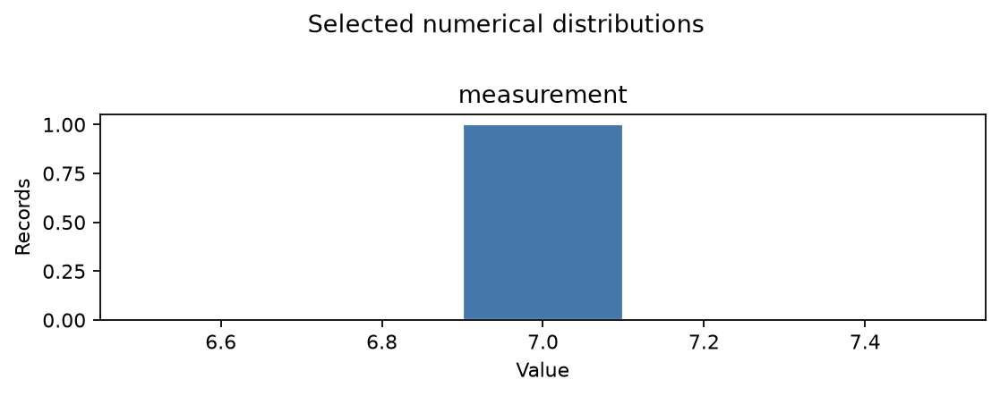

# Data Inspection Report

*Researcher-centric investigation of input.csv*

## Overview

This CSV dataset contains **1 records** across **1 variables** (1 integer). It uses 16 bytes on disk and about 190 bytes in the profiled DataFrame.

| First-page summary | Evidence |
| --- | --- |
| Overall completeness | 100% (0 missing cells across 0 variables) |
| Exact duplicate records | 0 additional occurrence(s) beyond the first |
| Identifier-like variables | 0 |
| Review findings | 1 |

| Metric | Value |
| --- | --- |
| Source file | input.csv |
| Source path | /private/var/folders/s1/btpgk25n7sv111nptxn92m2r0000gn/T/pytest-of-tanweerulhaque/pytest-0/test_single_numeric_row_has_un0/input.csv |
| Extension | .csv |
| Format | CSV |
| File size | 16 bytes |
| Rows | 1 |
| Columns | 1 |
| Estimated in-memory size | 190 bytes |

### Priority observations

- **Constant numeric column** in **measurement**: All finite numeric values are identical.

Initial assessment: the source was profiled without changing values. These are investigation prompts, not automatic corrections or scientific validation.

## Overall summary

- Missing cells: 0 across 0 column(s).
- Additional duplicate rows: 0.
- Potential quality findings: 1.

## Schema inventory

### Chapter 1: Understanding what is in the dataset

The schema comprises 1 integer. 0 variable(s) are identifier-like and are not interpreted as measurements.

| Column | Non-null | Inferred semantic type | Observed types (count) | Likely identifier |
| --- | --- | --- | --- | --- |
| measurement | 1 | integer | integer: 1 | No |

| Variable | Type | Non-null | Distinct | Note |
| --- | --- | --- | --- | --- |
| measurement | integer | 1 | 1 |  |

## Missing values

### Chapter 2: Can I rely on the completeness of this data?

Overall completeness is **100%**. No missing cells remain after configured marker normalization.

| Column | Missing | Missing % | Non-null | High missingness |
| --- | --- | --- | --- | --- |
| measurement | 0 | 0% | 1 | No |

## Duplicate rows

The count is additional full-row occurrences beyond the first occurrence in each group after missing-value normalization.

| Metric | Value |
| --- | --- |
| Additional duplicate rows | 0 |
| Share of all rows | 0% |

## Numeric summaries

### Chapter 3: What do the measurements tell us?

- **measurement**: range 7 to 7, median 7, distribution shape unavailable for this sample size.

*Histograms for selected numerical measurements; interpret scales separately.*

| Column | Finite count | Nonfinite excluded | Minimum | Maximum | Mean | Median | Sample std (ddof=1) | Q1 (25%) | Q3 (75%) | Scope / notes |
| --- | --- | --- | --- | --- | --- | --- | --- | --- | --- | --- |
| measurement | 1 | 0 | 7 | 7 | 7 | 7 | N/A | 7 | 7 | Finite numeric values |

## Categorical summaries

### Chapter 4: Are the categorical variables consistent?

No non-identifier categorical variables were available for review.

| Column | Distinct (non-missing) | Most frequent value | Frequency (non-missing) | Top values (count) | Notes |
| --- | --- | --- | --- | --- | --- |

### Chapter 5: How do variables relate to one another?

There were not enough varying numerical variables with complete pairs to estimate correlations.

## Data quality findings

### Chapter 6: What should concern the researcher?

### Constant numeric column — measurement

**Detected:** All finite numeric values are identical.

**Rule:** Minimum equals maximum among finite numeric values.

**Why investigate:** A constant measurement cannot explain variation; check whether this is expected.

| Check name | Column | Severity | Evidence | Rule | Explanation |
| --- | --- | --- | --- | --- | --- |
| Constant numeric column | measurement | warning | All finite numeric values are identical. | Minimum equals maximum among finite numeric values. | A constant measurement cannot explain variation; check whether this is expected. |

### Chapter 7: Recommended next investigations

- Review provenance, units, sampling frame and domain constraints; these cannot be established from a file profile alone.

## Rules and limitations

### Chapter 8: Methodology and limitations

Missing strings are normalized using configured trimmed, case-insensitive markers; JSON null and absent keys are missing. Numerical summaries use finite float64 values, linear quartiles and sample standard deviation. IQR alerts use strict fences; Pearson and Spearman associations use complete pairs. The tool processes the full file in memory.

Statistical observations are not errors by themselves. This tool does not validate units, study design, causality, scientific plausibility, nested JSON or JSON Lines.

### Technical appendix

#### Complete schema inventory

| Variable | Type | Non-null | Distinct | Observed values | Identifier-like |
| --- | --- | --- | --- | --- | --- |
| measurement | integer | 1 | 1 | integer: 1 | No |

#### Numerical statistics appendix

| Variable | Finite | Min | Max | Mean | Median | Std | Variance | Q1 | Q3 | Skew | Kurtosis | Zeros |
| --- | --- | --- | --- | --- | --- | --- | --- | --- | --- | --- | --- | --- |
| measurement | 1 | 7 | 7 | 7 | 7 | N/A | N/A | 7 | 7 | N/A | N/A | 0 (0%) |

#### Detailed quality evidence

| Check | Location | Severity | Evidence | Rule |
| --- | --- | --- | --- | --- |
| Constant numeric column | measurement | warning | All finite numeric values are identical. | Minimum equals maximum among finite numeric values. |
