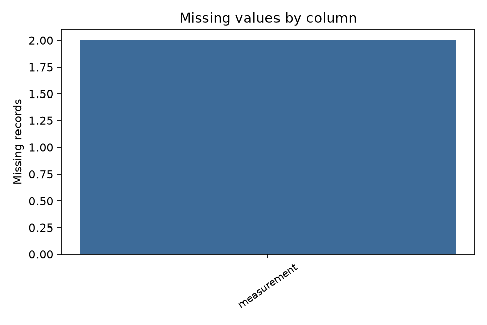
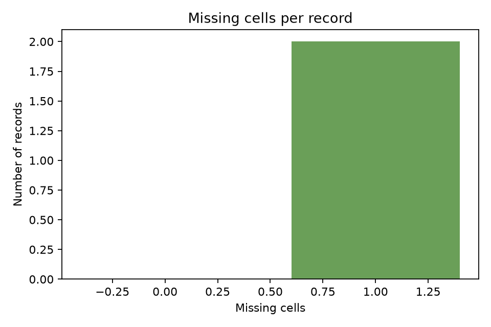

# Data Inspection Report

*Researcher-centric investigation of input.csv*

## Overview

This CSV dataset contains **2 records** across **1 variables** (1 empty). It uses 21 bytes on disk and about 180 bytes in the profiled DataFrame.

| First-page summary | Evidence |
| --- | --- |
| Overall completeness | 0% (2 missing cells across 1 variables) |
| Exact duplicate records | 1 additional occurrence(s) beyond the first |
| Identifier-like variables | 0 |
| Review findings | 3 |

| Metric | Value |
| --- | --- |
| Source file | input.csv |
| Source path | /private/var/folders/s1/btpgk25n7sv111nptxn92m2r0000gn/T/pytest-of-tanweerulhaque/pytest-0/test_all_null_column_is_empty_0/input.csv |
| Extension | .csv |
| Format | CSV |
| File size | 21 bytes |
| Rows | 2 |
| Columns | 1 |
| Estimated in-memory size | 180 bytes |

### Priority observations

- **All-null column** in **measurement**: No non-missing values were observed.
- **Duplicate rows**: 1 repeated row(s) beyond the first occurrence.
- **High missingness** in **measurement**: 2 missing of 2 values (100.00%).

Initial assessment: the source was profiled without changing values. These are investigation prompts, not automatic corrections or scientific validation.

## Overall summary

- Missing cells: 2 across 1 column(s).
- Additional duplicate rows: 1.
- Potential quality findings: 3.

## Schema inventory

### Chapter 1: Understanding what is in the dataset

The schema comprises 1 empty. 0 variable(s) are identifier-like and are not interpreted as measurements.

| Column | Non-null | Inferred semantic type | Observed types (count) | Likely identifier |
| --- | --- | --- | --- | --- |
| measurement | 0 | empty | N/A | No |

| Variable | Type | Non-null | Distinct | Note |
| --- | --- | --- | --- | --- |
| measurement | empty | 0 | 0 | All missing |

## Missing values

### Chapter 2: Can I rely on the completeness of this data?

Overall completeness is **0%**. Missingness affects 1 variable(s).

Most affected variables: **measurement** 2 (100%).

| Column | Missing | Missing % | Non-null | High missingness |
| --- | --- | --- | --- | --- |
| measurement | 2 | 100% | 0 | Yes |

2 record(s) have at least 50% of fields missing.

*Columns ranked by the number of missing records.*

*Distribution of missing-cell burden across records.*

## Duplicate rows

The count is additional full-row occurrences beyond the first occurrence in each group after missing-value normalization.

| Metric | Value |
| --- | --- |
| Additional duplicate rows | 1 |
| Share of all rows | 50% |

## Numeric summaries

### Chapter 3: What do the measurements tell us?

No non-identifier numerical variables had finite values suitable for this narrative.

| Column | Finite count | Nonfinite excluded | Minimum | Maximum | Mean | Median | Sample std (ddof=1) | Q1 (25%) | Q3 (75%) | Scope / notes |
| --- | --- | --- | --- | --- | --- | --- | --- | --- | --- | --- |

## Categorical summaries

### Chapter 4: Are the categorical variables consistent?

No non-identifier categorical variables were available for review.

| Column | Distinct (non-missing) | Most frequent value | Frequency (non-missing) | Top values (count) | Notes |
| --- | --- | --- | --- | --- | --- |

### Chapter 5: How do variables relate to one another?

There were not enough varying numerical variables with complete pairs to estimate correlations.

## Data quality findings

### Chapter 6: What should concern the researcher?

### All-null column — measurement

**Detected:** No non-missing values were observed.

**Rule:** Column has zero non-null values after missing-value normalization.

**Why investigate:** Check whether data collection failed or the field is intentionally reserved.

### Duplicate rows

**Detected:** 1 repeated row(s) beyond the first occurrence.

**Rule:** Full-row equality after missing-value normalization; count additional occurrences only.

**Why investigate:** Check whether repeated records are intended replicates before removing anything.

### High missingness — measurement

**Detected:** 2 missing of 2 values (100.00%).

**Rule:** High missingness when missing fraction &gt;= 5.0%; any missing values are reported.

**Why investigate:** Review collection coverage before relying on this column; no imputation has been performed.

| Check name | Column | Severity | Evidence | Rule | Explanation |
| --- | --- | --- | --- | --- | --- |
| All-null column | measurement | warning | No non-missing values were observed. | Column has zero non-null values after missing-value normalization. | Check whether data collection failed or the field is intentionally reserved. |
| Duplicate rows | (whole dataset) | warning | 1 repeated row(s) beyond the first occurrence. | Full-row equality after missing-value normalization; count additional occurrences only. | Check whether repeated records are intended replicates before removing anything. |
| High missingness | measurement | warning | 2 missing of 2 values (100.00%). | High missingness when missing fraction &gt;= 5.0%; any missing values are reported. | Review collection coverage before relying on this column; no imputation has been performed. |

### Chapter 7: Recommended next investigations

- Trace missing fields to collection or export steps before selecting a treatment; distinguish unavailable measurements from not-applicable values.
- Check repeated records and strongly aligned variables against the study design before removing rows or selecting predictors.

## Rules and limitations

### Chapter 8: Methodology and limitations

Missing strings are normalized using configured trimmed, case-insensitive markers; JSON null and absent keys are missing. Numerical summaries use finite float64 values, linear quartiles and sample standard deviation. IQR alerts use strict fences; Pearson and Spearman associations use complete pairs. The tool processes the full file in memory.

Statistical observations are not errors by themselves. This tool does not validate units, study design, causality, scientific plausibility, nested JSON or JSON Lines.

### Technical appendix

#### Complete schema inventory

| Variable | Type | Non-null | Distinct | Observed values | Identifier-like |
| --- | --- | --- | --- | --- | --- |
| measurement | empty | 0 | 0 | N/A | No |

#### Numerical statistics appendix

No numerical summaries are available.

#### Detailed quality evidence

| Check | Location | Severity | Evidence | Rule |
| --- | --- | --- | --- | --- |
| All-null column | measurement | warning | No non-missing values were observed. | Column has zero non-null values after missing-value normalization. |
| Duplicate rows | Dataset | warning | 1 repeated row(s) beyond the first occurrence. | Full-row equality after missing-value normalization; count additional occurrences only. |
| High missingness | measurement | warning | 2 missing of 2 values (100.00%). | High missingness when missing fraction &gt;= 5.0%; any missing values are reported. |
