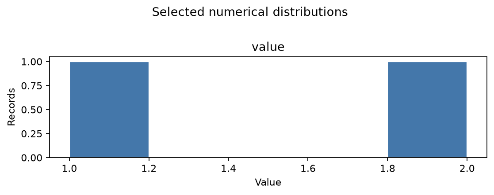
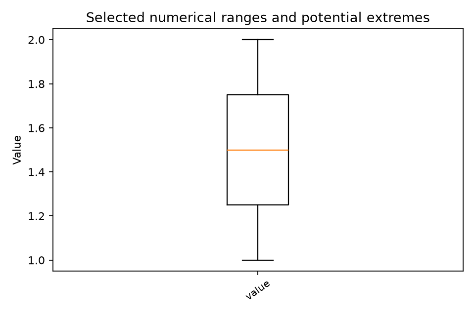

# Data Inspection Report

*Researcher-centric investigation of input.csv*

## Overview

This CSV dataset contains **2 records** across **1 variables** (1 integer). It uses 10 bytes on disk and about 248 bytes in the profiled DataFrame.

| First-page summary | Evidence |
| --- | --- |
| Overall completeness | 100% (0 missing cells across 0 variables) |
| Exact duplicate records | 0 additional occurrence(s) beyond the first |
| Identifier-like variables | 0 |
| Review findings | 0 |

| Metric | Value |
| --- | --- |
| Source file | input.csv |
| Source path | /private/var/folders/s1/btpgk25n7sv111nptxn92m2r0000gn/T/pytest-of-tanweerulhaque/pytest-7/test_two_default_runs_have_dis0/input.csv |
| Extension | .csv |
| Format | CSV |
| File size | 10 bytes |
| Rows | 2 |
| Columns | 1 |
| Estimated in-memory size | 248 bytes |

### Priority observations

- No configured structural or statistical prompts were produced. This is not proof of fitness for a research question.

Initial assessment: the source was profiled without changing values. These are investigation prompts, not automatic corrections or scientific validation.

## Overall summary

- Missing cells: 0 across 0 column(s).
- Additional duplicate rows: 0.
- Potential quality findings: 0.
- No potential issues detected by the configured rules. This does not guarantee clean data.

## Schema inventory

### Chapter 1: Understanding what is in the dataset

The schema comprises 1 integer. 0 variable(s) are identifier-like and are not interpreted as measurements. Observed scalar types show the evidence used for inference.

| Column | Non-null | Inferred semantic type | Observed types (count) | Likely identifier |
| --- | --- | --- | --- | --- |
| value | 2 | integer | integer: 2 | No |

| Variable | Type | Non-null | Distinct | Note |
| --- | --- | --- | --- | --- |
| value | integer | 2 | 2 |  |

## Missing values

### Chapter 2: Can I rely on the completeness of this data?

Overall completeness is **100%**. No missing cells remain after configured marker normalization. High missingness means at least 5% missing.

| Column | Missing | Missing % | Non-null | High missingness |
| --- | --- | --- | --- | --- |
| value | 0 | 0% | 2 | No |

## Duplicate rows

The count is additional full-row occurrences beyond the first occurrence in each group after missing-value normalization; for example, three identical rows contribute two additional rows.

| Metric | Value |
| --- | --- |
| Additional duplicate rows | 0 |
| Share of all rows | 0% |

## Numeric summaries

### Chapter 3: What do the measurements tell us?

Finite numeric values are summarized with linear quartiles and sample standard deviation (ddof=1). Mixed columns describe their numeric subset only.

- **value**: range 1 to 2, median 1.5, distribution shape unavailable for this sample size.

*Histograms for selected numerical measurements; interpret scales separately.*

*Selected numerical ranges; points beyond whiskers are distributional candidates, not errors.*

| Column | Finite count | Nonfinite excluded | Minimum | Maximum | Mean | Median | Sample std (ddof=1) | Q1 (25%) | Q3 (75%) | Scope / notes |
| --- | --- | --- | --- | --- | --- | --- | --- | --- | --- | --- |
| value | 2 | 0 | 1 | 2 | 1.5 | 1.5 | 0.707107 | 1.25 | 1.75 | Finite numeric values |

## Categorical summaries

### Chapter 4: Are the categorical variables consistent?

Up to 5 most frequent non-missing values are shown; likely identifiers suppress modes and top values.

No non-identifier categorical variables were available for review.

| Column | Distinct (non-missing) | Most frequent value | Frequency (non-missing) | Top values (count) | Notes |
| --- | --- | --- | --- | --- | --- |

### Chapter 5: How do variables relate to one another?

There were not enough varying numerical variables with complete pairs to estimate correlations.

## Data quality findings

### Chapter 6: What should concern the researcher?

No configured alerts need prioritisation. No potential issues detected by the configured rules. This does not guarantee clean data.

| Check name | Column | Severity | Evidence | Rule | Explanation |
| --- | --- | --- | --- | --- | --- |

### Chapter 7: Recommended next investigations

- Review provenance, units, sampling frame and domain constraints; these cannot be established from a file profile alone.

## Rules and limitations

### Chapter 8: Methodology and limitations

Missing strings are normalized using configured trimmed, case-insensitive markers; JSON null and absent keys are missing. Numerical summaries use finite float64 values, linear quartiles and sample standard deviation. IQR alerts use strict fences; Pearson and Spearman associations use complete pairs. The tool processes the full file in memory.

Configured rules: missing fraction >= 5%; CSV mixed inference requires at least 80% numeric values; potential outliers use Q1 - 1.5 × IQR and Q3 + 1.5 × IQR and are skipped for zero IQR or fewer than 4 finite values. Pandas/NumPy floating-point calculations can round large integers. JSON preserves native types: quoted numbers and booleans remain strings. Nonfinite values are flagged and excluded from numeric statistics and outlier fences.

Statistical observations are not errors by themselves. This tool does not validate units, study design, causality, scientific plausibility, no domain schema, nested JSON or JSON Lines. Input is processed in memory, not streamed, and the source file is never modified.

### Technical appendix

#### Complete schema inventory

| Variable | Type | Non-null | Distinct | Observed values | Identifier-like |
| --- | --- | --- | --- | --- | --- |
| value | integer | 2 | 2 | integer: 2 | No |

#### Numerical statistics appendix

| Variable | Finite | Min | Max | Mean | Median | Std | Variance | Q1 | Q3 | Skew | Kurtosis | Zeros |
| --- | --- | --- | --- | --- | --- | --- | --- | --- | --- | --- | --- | --- |
| value | 2 | 1 | 2 | 1.5 | 1.5 | 0.707107 | 0.5 | 1.25 | 1.75 | N/A | N/A | 0 (0%) |

#### Detailed quality evidence

No configured quality findings.
