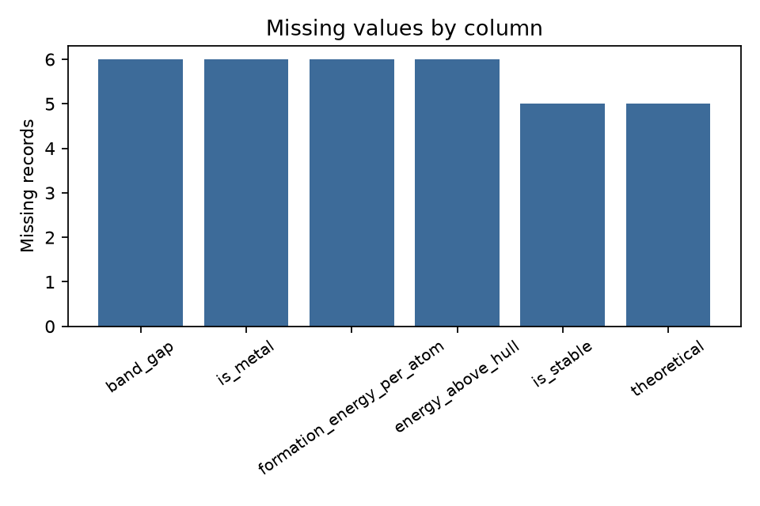
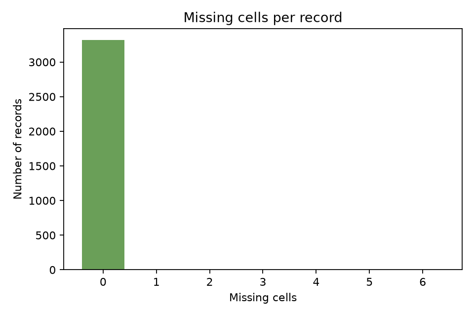
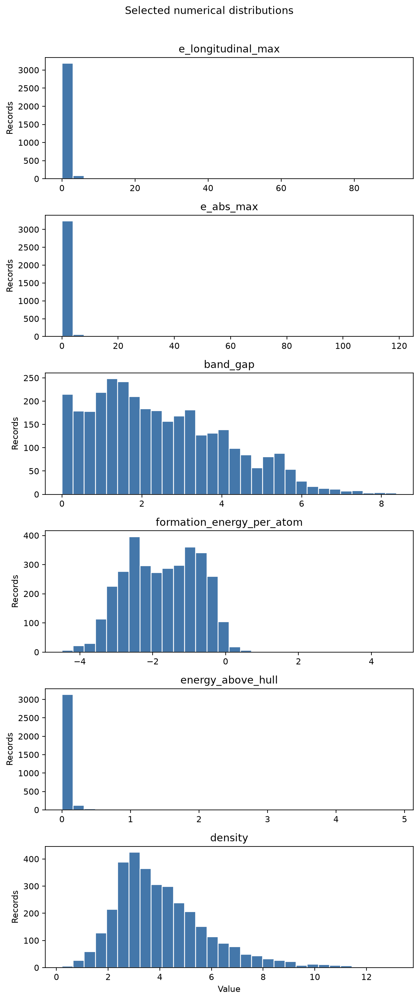
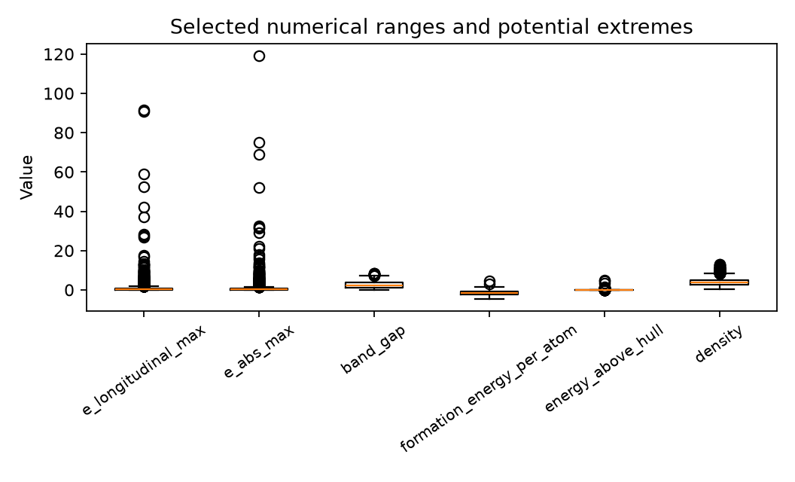
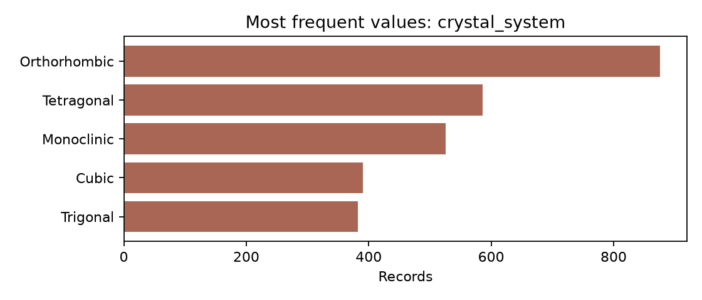
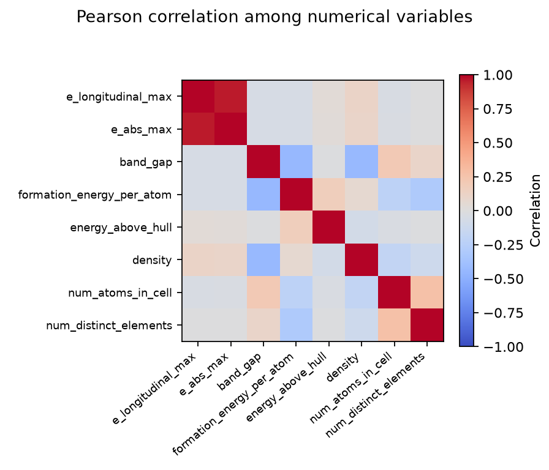

# Data Inspection Report

*Researcher-centric investigation of materials_piezoelectric_properties.parquet*

## Overview

This PARQUET dataset contains **3,322 records** across **15 variables** (3 boolean, 2 integer, 6 number, 4 string). It uses 242,785 bytes (237.095 KiB) on disk and about 425,262 bytes (415.295 KiB) in the profiled DataFrame.

| First-page summary | Evidence |
| --- | --- |
| Overall completeness | 99.9318% (34 missing cells across 6 variables) |
| Exact duplicate records | 0 additional occurrence(s) beyond the first |
| Identifier-like variables | 1 |
| Review findings | 16 |

| Metric | Value |
| --- | --- |
| Source file | materials_piezoelectric_properties.parquet |
| Source path | data/demo/materials_piezoelectric_properties.parquet |
| Extension | .parquet |
| Format | PARQUET |
| File size | 242,785 bytes (237.095 KiB) |
| Rows | 3,322 |
| Columns | 15 |
| Estimated in-memory size | 425,262 bytes (415.295 KiB) |

### Priority observations

- **Missing values** in **band_gap**: 6 missing of 3,322 values (0.18%).
- **Missing values** in **energy_above_hull**: 6 missing of 3,322 values (0.18%).
- **Missing values** in **formation_energy_per_atom**: 6 missing of 3,322 values (0.18%).
- **Missing values** in **is_metal**: 6 missing of 3,322 values (0.18%).
- **Missing values** in **is_stable**: 5 missing of 3,322 values (0.15%).

Initial assessment: the source was profiled without changing values. These are investigation prompts, not automatic corrections or scientific validation.

## Overall summary

- Missing cells: 34 across 6 column(s).
- Additional duplicate rows: 0.
- Potential quality findings: 16.
- Findings by severity: info: 16.

## Schema inventory

### Chapter 1: Understanding what is in the dataset

The schema comprises 3 boolean, 2 integer, 6 number, 4 string. 1 variable(s) are identifier-like and are not interpreted as measurements. Observed scalar types show the evidence used for inference.

| Column | Non-null | Inferred semantic type | Observed types (count) | Likely identifier |
| --- | --- | --- | --- | --- |
| material_id | 3,322 | string | string: 3,322 | Yes |
| formula_pretty | 3,322 | string | string: 3,322 | No |
| e_longitudinal_max | 3,322 | number | number: 3,322 | No |
| e_abs_max | 3,322 | number | number: 3,322 | No |
| band_gap | 3,316 | number | number: 3,316 | No |
| crystal_system | 3,322 | string | string: 3,322 | No |
| point_group | 3,322 | string | string: 3,322 | No |
| is_metal | 3,316 | boolean | boolean: 3,316 | No |
| formation_energy_per_atom | 3,316 | number | number: 3,316 | No |
| energy_above_hull | 3,316 | number | number: 3,316 | No |
| density | 3,322 | number | number: 3,322 | No |
| is_stable | 3,317 | boolean | boolean: 3,317 | No |
| theoretical | 3,317 | boolean | boolean: 3,317 | No |
| num_atoms_in_cell | 3,322 | integer | integer: 3,322 | No |
| num_distinct_elements | 3,322 | integer | integer: 3,322 | No |

| Variable | Type | Non-null | Distinct | Note |
| --- | --- | --- | --- | --- |
| material_id | string | 3,322 | 3,322 | Identifier-like |
| formula_pretty | string | 3,322 | 2,817 |  |
| e_longitudinal_max | number | 3,322 | 3,231 |  |
| e_abs_max | number | 3,322 | 3,295 |  |
| band_gap | number | 3,316 | 3,205 |  |
| crystal_system | string | 3,322 | 7 |  |
| point_group | string | 3,322 | 21 |  |
| is_metal | boolean | 3,316 | 2 |  |
| formation_energy_per_atom | number | 3,316 | 3,315 |  |
| energy_above_hull | number | 3,316 | 2,050 |  |
| density | number | 3,322 | 3,322 |  |
| is_stable | boolean | 3,317 | 2 |  |
| theoretical | boolean | 3,317 | 2 |  |
| num_atoms_in_cell | integer | 3,322 | 69 |  |
| num_distinct_elements | integer | 3,322 | 6 |  |

## Missing values

### Chapter 2: Can I rely on the completeness of this data?

Overall completeness is **99.9318%**. Missingness affects 6 variable(s). High missingness means at least 5% missing.

Most affected variables: **band_gap** 6 (0.180614%); **is_metal** 6 (0.180614%); **formation_energy_per_atom** 6 (0.180614%); **energy_above_hull** 6 (0.180614%); **is_stable** 5 (0.150512%).

| Column | Missing | Missing % | Non-null | High missingness |
| --- | --- | --- | --- | --- |
| material_id | 0 | 0% | 3,322 | No |
| formula_pretty | 0 | 0% | 3,322 | No |
| e_longitudinal_max | 0 | 0% | 3,322 | No |
| e_abs_max | 0 | 0% | 3,322 | No |
| band_gap | 6 | 0.180614% | 3,316 | No |
| crystal_system | 0 | 0% | 3,322 | No |
| point_group | 0 | 0% | 3,322 | No |
| is_metal | 6 | 0.180614% | 3,316 | No |
| formation_energy_per_atom | 6 | 0.180614% | 3,316 | No |
| energy_above_hull | 6 | 0.180614% | 3,316 | No |
| density | 0 | 0% | 3,322 | No |
| is_stable | 5 | 0.150512% | 3,317 | No |
| theoretical | 5 | 0.150512% | 3,317 | No |
| num_atoms_in_cell | 0 | 0% | 3,322 | No |
| num_distinct_elements | 0 | 0% | 3,322 | No |

Row burden: 6 of 3,322 record(s) have at least one missing cell; the worst record misses 6 of 15 fields.

#### Most common missing-value patterns

Each pattern is the exact set of fields missing together in a record.

| Missing together | Records | Share of records |
| --- | --- | --- |
| band_gap, is_metal, formation_energy_per_atom, energy_above_hull, is_stable, theoretical | 5 | 0.150512% |
| band_gap, is_metal, formation_energy_per_atom, energy_above_hull | 1 | 0.0301023% |

The most common pair of absent fields is **band_gap** and **is_metal** (6 records); review their shared collection path.

#### Fields missing in the same records

| Field A | Field B | Records missing both |
| --- | --- | --- |
| band_gap | is_metal | 6 |
| band_gap | formation_energy_per_atom | 6 |
| band_gap | energy_above_hull | 6 |
| is_metal | formation_energy_per_atom | 6 |
| is_metal | energy_above_hull | 6 |

*Columns ranked by the number of missing records.*

*Distribution of missing-cell burden across records.*

## Duplicate rows

The count is additional full-row occurrences beyond the first occurrence in each group after missing-value normalization; for example, three identical rows contribute two additional rows.

| Metric | Value |
| --- | --- |
| Additional duplicate rows | 0 |
| Share of all rows | 0% |

## Numeric summaries

### Chapter 3: What do the measurements tell us?

Finite numeric values are summarized with linear quartiles and sample standard deviation (ddof=1). Mixed columns describe their numeric subset only.

- **e_abs_max**: range 0 to 119.036, median 0.332815, skewness 22.1061. Zeros: 0.662252%.
- **energy_above_hull**: range 0 to 4.88245, median 0.00741184, skewness 20.6049. Zeros: 38.2087%.
- **e_longitudinal_max**: range 0 to 91.5779, median 0.317153, skewness 19.4564. Zeros: 0.662252%.
- **num_atoms_in_cell**: range 2 to 288, median 20, skewness 2.96894.
- **density**: range 0.212291 to 13.1605, median 3.75548, skewness 1.15961.

*Histograms for selected numerical measurements; interpret scales separately.*

*Selected numerical ranges; points beyond whiskers are distributional candidates, not errors.*

| Column | Finite count | Nonfinite excluded | Minimum | Maximum | Mean | Median | Sample std (ddof=1) | Q1 (25%) | Q3 (75%) | Mode | Zero share | Scope / notes |
| --- | --- | --- | --- | --- | --- | --- | --- | --- | --- | --- | --- | --- |
| e_longitudinal_max | 3,322 | 0 | 0 | 91.5779 | 0.820654 | 0.317153 | 3.14961 | 0.124283 | 0.754926 | 0 | 0.662252% | Finite numeric values |
| e_abs_max | 3,322 | 0 | 0 | 119.036 | 0.835579 | 0.332815 | 3.31699 | 0.145245 | 0.73894 | 0 | 0.662252% | Finite numeric values |
| band_gap | 3,316 | 0 | 0 | 8.3751 | 2.47956 | 2.20635 | 1.6682 | 1.163 | 3.6265 | 0 | 2.35223% | Finite numeric values |
| formation_energy_per_atom | 3,316 | 0 | -4.48897 | 4.6882 | -1.72703 | -1.71284 | 0.99019 | -2.52346 | -0.898324 | 0 | 0.0603136% | Finite numeric values |
| energy_above_hull | 3,316 | 0 | 0 | 4.88245 | 0.0454466 | 0.00741184 | 0.157745 | 0 | 0.0554358 | 0 | 38.2087% | Finite numeric values |
| density | 3,322 | 0 | 0.212291 | 13.1605 | 4.10656 | 3.75548 | 1.83666 | 2.81446 | 5.04347 | 0.212291 | 0% | Finite numeric values |
| num_atoms_in_cell | 3,322 | 0 | 2 | 288 | 22.1969 | 20 | 15.9073 | 12 | 28 | 16 | 0% | Finite numeric values |
| num_distinct_elements | 3,322 | 0 | 1 | 6 | 3.30042 | 3 | 0.799763 | 3 | 4 | 3 | 0% | Finite numeric values |

## Categorical summaries

### Chapter 4: Are the categorical variables consistent?

Up to 5 most frequent non-missing values are shown; likely identifiers suppress modes and top values.

- **formula_pretty**: 2,817 distinct values; most common is "SiO2" (44/3,322).
- **crystal_system**: 7 distinct values; most common is "Orthorhombic" (876/3,322).
- **point_group**: 21 distinct values; most common is "mm2" (641/3,322).
- **is_metal**: 2 distinct values; most common is false (3,238/3,316).
- **is_stable**: 2 distinct values; most common is false (2,050/3,317).

*Most frequent observed values for crystal_system.*

| Column | Distinct (non-missing) | Most frequent value | Frequency (non-missing) | Top values (count) | Notes |
| --- | --- | --- | --- | --- | --- |
| material_id | 3,322 | N/A | N/A | N/A | Likely identifier; mode and top values suppressed |
| formula_pretty | 2,817 | "SiO2" | 44 / 3,322 (1.3245%) | "SiO2" (44); "ZnS" (13); "LiMnPO4" (10); "Li4CO4" (9); "LiFeSiO4" (9) |  |
| crystal_system | 7 | "Orthorhombic" | 876 / 3,322 (26.3697%) | "Orthorhombic" (876); "Tetragonal" (586); "Monoclinic" (526); "Cubic" (391); "Trigonal" (382) |  |
| point_group | 21 | "mm2" | 641 / 3,322 (19.2956%) | "mm2" (641); "-42m" (289); "-43m" (284); "2" (270); "m" (260) |  |
| is_metal | 2 | false | 3,238 / 3,316 (97.6478%) | false (3,238); true (78) |  |
| is_stable | 2 | false | 2,050 / 3,317 (61.8028%) | false (2,050); true (1,267) |  |
| theoretical | 2 | false | 1,766 / 3,317 (53.2409%) | false (1,766); true (1,551) |  |

#### Text value summaries

Lengths are in characters for non-missing string values; whitespace counts values with leading/trailing spaces.

| Column | Strings | Empty | Leading/trailing whitespace | Case-only variants | Min length | Mean length | Max length |
| --- | --- | --- | --- | --- | --- | --- | --- |
| material_id | 3,322 | 0 | 0 | 0 | 11 | 11 | 11 |
| formula_pretty | 3,322 | 0 | 0 | 0 | 1 | 7.18964 | 19 |
| crystal_system | 3,322 | 0 | 0 | 0 | 5 | 9.54004 | 12 |
| point_group | 3,322 | 0 | 0 | 0 | 1 | 2.49127 | 4 |

### Chapter 5: How do variables relate to one another?

- **e_longitudinal_max** and **e_abs_max**: Pearson 0.958184, Spearman 0.950649 across 3,322 complete pairs.
- **band_gap** and **density**: Pearson -0.43468, Spearman -0.461475 across 3,316 complete pairs.
- **band_gap** and **formation_energy_per_atom**: Pearson -0.442197, Spearman -0.455556 across 3,316 complete pairs.
- **num_atoms_in_cell** and **num_distinct_elements**: Pearson 0.2678, Spearman 0.347434 across 3,322 complete pairs.
- **formation_energy_per_atom** and **num_atoms_in_cell**: Pearson -0.217993, Spearman -0.332654 across 3,316 complete pairs.

*Pearson correlations among selected numerical variables; association is not causation.*

## Data quality findings

### Chapter 6: What should concern the researcher?

### Missing values — band_gap

**Detected:** 6 missing of 3,322 values (0.18%).

**Rule:** High missingness when missing fraction &gt;= 5.0%; any missing values are reported.

**Why investigate:** Review collection coverage before relying on this column; no imputation has been performed.

### Missing values — energy_above_hull

**Detected:** 6 missing of 3,322 values (0.18%).

**Rule:** High missingness when missing fraction &gt;= 5.0%; any missing values are reported.

**Why investigate:** Review collection coverage before relying on this column; no imputation has been performed.

### Missing values — formation_energy_per_atom

**Detected:** 6 missing of 3,322 values (0.18%).

**Rule:** High missingness when missing fraction &gt;= 5.0%; any missing values are reported.

**Why investigate:** Review collection coverage before relying on this column; no imputation has been performed.

### Missing values — is_metal

**Detected:** 6 missing of 3,322 values (0.18%).

**Rule:** High missingness when missing fraction &gt;= 5.0%; any missing values are reported.

**Why investigate:** Review collection coverage before relying on this column; no imputation has been performed.

### Missing values — is_stable

**Detected:** 5 missing of 3,322 values (0.15%).

**Rule:** High missingness when missing fraction &gt;= 5.0%; any missing values are reported.

**Why investigate:** Review collection coverage before relying on this column; no imputation has been performed.

### Missing values — theoretical

**Detected:** 5 missing of 3,322 values (0.15%).

**Rule:** High missingness when missing fraction &gt;= 5.0%; any missing values are reported.

**Why investigate:** Review collection coverage before relying on this column; no imputation has been performed.

### Potential numerical outliers — band_gap

**Detected:** 13/3,316 finite numeric values outside IQR fences \[-2.53225, 7.32175\]. Examples: 8.0901, 8.3196, 7.9151, 7.56956, 8.246.

**Rule:** x &lt; Q1 - 1.5 × IQR or x &gt; Q3 + 1.5 × IQR; linear quartiles, strict inequalities.

**Why investigate:** Potential outliers are not confirmed errors. Skewed or multimodal distributions may naturally produce them.

### Potential numerical outliers — density

**Detected:** 105/3,322 finite numeric values outside IQR fences \[-0.529042, 8.38698\]. Examples: 9.70251, 8.8536, 9.33643, 13.1605, 8.89946.

**Rule:** x &lt; Q1 - 1.5 × IQR or x &gt; Q3 + 1.5 × IQR; linear quartiles, strict inequalities.

**Why investigate:** Potential outliers are not confirmed errors. Skewed or multimodal distributions may naturally produce them.

### Potential numerical outliers — e_abs_max

**Detected:** 307/3,322 finite numeric values outside IQR fences \[-0.745298, 1.62948\]. Examples: 6.53956, 1.80003, 2.47331, 2.74012, 1.71795.

**Rule:** x &lt; Q1 - 1.5 × IQR or x &gt; Q3 + 1.5 × IQR; linear quartiles, strict inequalities.

**Why investigate:** Potential outliers are not confirmed errors. Skewed or multimodal distributions may naturally produce them.

### Potential numerical outliers — e_longitudinal_max

**Detected:** 273/3,322 finite numeric values outside IQR fences \[-0.821683, 1.70089\]. Examples: 7.55048, 1.79911, 2.47258, 2.74, 1.71806.

**Rule:** x &lt; Q1 - 1.5 × IQR or x &gt; Q3 + 1.5 × IQR; linear quartiles, strict inequalities.

**Why investigate:** Potential outliers are not confirmed errors. Skewed or multimodal distributions may naturally produce them.

### Potential numerical outliers — energy_above_hull

**Detected:** 213/3,316 finite numeric values outside IQR fences \[-0.0831537, 0.13859\]. Examples: 0.360776, 0.251843, 0.399725, 0.223489, 0.322402.

**Rule:** x &lt; Q1 - 1.5 × IQR or x &gt; Q3 + 1.5 × IQR; linear quartiles, strict inequalities.

**Why investigate:** Potential outliers are not confirmed errors. Skewed or multimodal distributions may naturally produce them.

### Potential numerical outliers — formation_energy_per_atom

**Detected:** 2/3,316 finite numeric values outside IQR fences \[-4.96116, 1.53938\]. Examples: 4.6882, 2.94862.

**Rule:** x &lt; Q1 - 1.5 × IQR or x &gt; Q3 + 1.5 × IQR; linear quartiles, strict inequalities.

**Why investigate:** Potential outliers are not confirmed errors. Skewed or multimodal distributions may naturally produce them.

| Check name | Column | Severity | Evidence | Rule | Explanation |
| --- | --- | --- | --- | --- | --- |
| Missing values | band_gap | info | 6 missing of 3,322 values (0.18%). | High missingness when missing fraction &gt;= 5.0%; any missing values are reported. | Review collection coverage before relying on this column; no imputation has been performed. |
| Missing values | energy_above_hull | info | 6 missing of 3,322 values (0.18%). | High missingness when missing fraction &gt;= 5.0%; any missing values are reported. | Review collection coverage before relying on this column; no imputation has been performed. |
| Missing values | formation_energy_per_atom | info | 6 missing of 3,322 values (0.18%). | High missingness when missing fraction &gt;= 5.0%; any missing values are reported. | Review collection coverage before relying on this column; no imputation has been performed. |
| Missing values | is_metal | info | 6 missing of 3,322 values (0.18%). | High missingness when missing fraction &gt;= 5.0%; any missing values are reported. | Review collection coverage before relying on this column; no imputation has been performed. |
| Missing values | is_stable | info | 5 missing of 3,322 values (0.15%). | High missingness when missing fraction &gt;= 5.0%; any missing values are reported. | Review collection coverage before relying on this column; no imputation has been performed. |
| Missing values | theoretical | info | 5 missing of 3,322 values (0.15%). | High missingness when missing fraction &gt;= 5.0%; any missing values are reported. | Review collection coverage before relying on this column; no imputation has been performed. |
| Potential numerical outliers | band_gap | info | 13/3,316 finite numeric values outside IQR fences \[-2.53225, 7.32175\]. Examples: 8.0901, 8.3196, 7.9151, 7.56956, 8.246. | x &lt; Q1 - 1.5 × IQR or x &gt; Q3 + 1.5 × IQR; linear quartiles, strict inequalities. | Potential outliers are not confirmed errors. Skewed or multimodal distributions may naturally produce them. |
| Potential numerical outliers | density | info | 105/3,322 finite numeric values outside IQR fences \[-0.529042, 8.38698\]. Examples: 9.70251, 8.8536, 9.33643, 13.1605, 8.89946. | x &lt; Q1 - 1.5 × IQR or x &gt; Q3 + 1.5 × IQR; linear quartiles, strict inequalities. | Potential outliers are not confirmed errors. Skewed or multimodal distributions may naturally produce them. |
| Potential numerical outliers | e_abs_max | info | 307/3,322 finite numeric values outside IQR fences \[-0.745298, 1.62948\]. Examples: 6.53956, 1.80003, 2.47331, 2.74012, 1.71795. | x &lt; Q1 - 1.5 × IQR or x &gt; Q3 + 1.5 × IQR; linear quartiles, strict inequalities. | Potential outliers are not confirmed errors. Skewed or multimodal distributions may naturally produce them. |
| Potential numerical outliers | e_longitudinal_max | info | 273/3,322 finite numeric values outside IQR fences \[-0.821683, 1.70089\]. Examples: 7.55048, 1.79911, 2.47258, 2.74, 1.71806. | x &lt; Q1 - 1.5 × IQR or x &gt; Q3 + 1.5 × IQR; linear quartiles, strict inequalities. | Potential outliers are not confirmed errors. Skewed or multimodal distributions may naturally produce them. |
| Potential numerical outliers | energy_above_hull | info | 213/3,316 finite numeric values outside IQR fences \[-0.0831537, 0.13859\]. Examples: 0.360776, 0.251843, 0.399725, 0.223489, 0.322402. | x &lt; Q1 - 1.5 × IQR or x &gt; Q3 + 1.5 × IQR; linear quartiles, strict inequalities. | Potential outliers are not confirmed errors. Skewed or multimodal distributions may naturally produce them. |
| Potential numerical outliers | formation_energy_per_atom | info | 2/3,316 finite numeric values outside IQR fences \[-4.96116, 1.53938\]. Examples: 4.6882, 2.94862. | x &lt; Q1 - 1.5 × IQR or x &gt; Q3 + 1.5 × IQR; linear quartiles, strict inequalities. | Potential outliers are not confirmed errors. Skewed or multimodal distributions may naturally produce them. |
| Potential numerical outliers | num_atoms_in_cell | info | 132/3,322 finite numeric values outside IQR fences \[-12, 52\]. Examples: 56, 80, 84, 54, 64. | x &lt; Q1 - 1.5 × IQR or x &gt; Q3 + 1.5 × IQR; linear quartiles, strict inequalities. | Potential outliers are not confirmed errors. Skewed or multimodal distributions may naturally produce them. |
| Potential numerical outliers | num_distinct_elements | info | 23/3,322 finite numeric values outside IQR fences \[1.5, 5.5\]. Examples: 6, 1. | x &lt; Q1 - 1.5 × IQR or x &gt; Q3 + 1.5 × IQR; linear quartiles, strict inequalities. | Potential outliers are not confirmed errors. Skewed or multimodal distributions may naturally produce them. |
| Rare categories | point_group | info | 6 category value(s) occur in at most 2.0% of non-missing records; examples: '3', '6', '622', '4', '432'. | Category frequency &lt;= 2.0%; evaluated for columns with at most 50 distinct values. | Rare labels may be valid minority classes, spelling variants, or data-entry errors. |
| Strong numerical correlation | e_longitudinal_max ↔ e_abs_max | info | Pearson=0.958, Spearman=0.951, based on 3,322 complete pair(s). | Absolute Pearson or Spearman correlation &gt;= 0.90. | The variables may be redundant or related; correlation does not establish causation. |

### Chapter 7: Recommended next investigations

- Trace missing fields to collection or export steps before selecting a treatment; distinguish unavailable measurements from not-applicable values.
- Review extreme observations and zeros against source records and units; decide whether they are valid measurements, censoring, or coding conventions.
- Inspect raw categorical labels before grouping them, and preserve an auditable normalization map if one is justified.
- Check repeated records and strongly aligned variables against the study design before removing rows or selecting predictors.

## Rules and limitations

### Chapter 8: Methodology and limitations

Missing strings are normalized only when the trimmed text exactly (case-sensitively) equals a configured marker ('NA', 'N/A', 'n/a', '#N/A', 'NULL', 'null', 'NaN', 'nan'); blanks, JSON null and absent keys are always missing, and every conversion is counted per column. ISO-like date text and native date/time values are summarised; naive times are compared as UTC. Numerical summaries use finite float64 values, linear quartiles and sample standard deviation. IQR alerts use strict fences; Pearson and Spearman associations use complete pairs. The tool processes the full file in memory.

Configured rules: missing fraction >= 5%; CSV mixed inference requires at least 80% numeric values; potential outliers use Q1 - 1.5 × IQR and Q3 + 1.5 × IQR and are skipped for zero IQR or fewer than 4 finite values. Pandas/NumPy floating-point calculations can round large integers. JSON preserves native types: quoted numbers and booleans remain strings. Nonfinite values are flagged and excluded from numeric statistics and outlier fences.

Statistical observations are not errors by themselves. This tool does not validate units, study design, causality, scientific plausibility, no domain schema, nested JSON or JSON Lines. Input is processed in memory, not streamed, and the source file is never modified.

### Chart availability

All applicable charts were generated.

| Chart | Status | Detail |
| --- | --- | --- |
| Missing values by column | generated | missingness.png |
| Missing cells per record | generated | row_missingness.png |
| Numerical histograms | generated | numeric_distributions.png |
| Numerical boxplots | generated | numeric_boxplots.png |
| Correlation heatmap | generated | correlation_heatmap.png |
| Category frequencies (crystal_system) | generated | categories_crystal_system_fcb548c6.png |

### Technical appendix

#### Complete schema inventory

| Variable | Type | Non-null | Distinct | Observed values | Identifier-like |
| --- | --- | --- | --- | --- | --- |
| material_id | string | 3,322 | 3,322 | string: 3,322 | Yes |
| formula_pretty | string | 3,322 | 2,817 | string: 3,322 | No |
| e_longitudinal_max | number | 3,322 | 3,231 | number: 3,322 | No |
| e_abs_max | number | 3,322 | 3,295 | number: 3,322 | No |
| band_gap | number | 3,316 | 3,205 | number: 3,316 | No |
| crystal_system | string | 3,322 | 7 | string: 3,322 | No |
| point_group | string | 3,322 | 21 | string: 3,322 | No |
| is_metal | boolean | 3,316 | 2 | boolean: 3,316 | No |
| formation_energy_per_atom | number | 3,316 | 3,315 | number: 3,316 | No |
| energy_above_hull | number | 3,316 | 2,050 | number: 3,316 | No |
| density | number | 3,322 | 3,322 | number: 3,322 | No |
| is_stable | boolean | 3,317 | 2 | boolean: 3,317 | No |
| theoretical | boolean | 3,317 | 2 | boolean: 3,317 | No |
| num_atoms_in_cell | integer | 3,322 | 69 | integer: 3,322 | No |
| num_distinct_elements | integer | 3,322 | 6 | integer: 3,322 | No |

#### Numerical statistics appendix

| Variable | Finite | Min | Max | Mean | Median | Mode | Std | Variance | Q1 | Q3 | Skew | Kurtosis | Zeros |
| --- | --- | --- | --- | --- | --- | --- | --- | --- | --- | --- | --- | --- | --- |
| e_longitudinal_max | 3,322 | 0 | 91.5779 | 0.820654 | 0.317153 | 0 | 3.14961 | 9.92003 | 0.124283 | 0.754926 | 19.4564 | 481.069 | 22 (0.662252%) |
| e_abs_max | 3,322 | 0 | 119.036 | 0.835579 | 0.332815 | 0 | 3.31699 | 11.0024 | 0.145245 | 0.73894 | 22.1061 | 640.372 | 22 (0.662252%) |
| band_gap | 3,316 | 0 | 8.3751 | 2.47956 | 2.20635 | 0 | 1.6682 | 2.78288 | 1.163 | 3.6265 | 0.595837 | -0.29364 | 78 (2.35223%) |
| formation_energy_per_atom | 3,316 | -4.48897 | 4.6882 | -1.72703 | -1.71284 | 0 | 0.99019 | 0.980477 | -2.52346 | -0.898324 | 0.0210505 | -0.309776 | 2 (0.0603136%) |
| energy_above_hull | 3,316 | 0 | 4.88245 | 0.0454466 | 0.00741184 | 0 | 0.157745 | 0.0248835 | 0 | 0.0554358 | 20.6049 | 566.572 | 1,267 (38.2087%) |
| density | 3,322 | 0.212291 | 13.1605 | 4.10656 | 3.75548 | 0.212291 | 1.83666 | 3.3733 | 2.81446 | 5.04347 | 1.15961 | 1.84569 | 0 (0%) |
| num_atoms_in_cell | 3,322 | 2 | 288 | 22.1969 | 20 | 16 | 15.9073 | 253.042 | 12 | 28 | 2.96894 | 28.4079 | 0 (0%) |
| num_distinct_elements | 3,322 | 1 | 6 | 3.30042 | 3 | 3 | 0.799763 | 0.63962 | 3 | 4 | 0.304792 | 0.112433 | 0 (0%) |

#### Detailed quality evidence

| Check | Location | Severity | Evidence | Rule |
| --- | --- | --- | --- | --- |
| Missing values | band_gap | info | 6 missing of 3,322 values (0.18%). | High missingness when missing fraction &gt;= 5.0%; any missing values are reported. |
| Missing values | energy_above_hull | info | 6 missing of 3,322 values (0.18%). | High missingness when missing fraction &gt;= 5.0%; any missing values are reported. |
| Missing values | formation_energy_per_atom | info | 6 missing of 3,322 values (0.18%). | High missingness when missing fraction &gt;= 5.0%; any missing values are reported. |
| Missing values | is_metal | info | 6 missing of 3,322 values (0.18%). | High missingness when missing fraction &gt;= 5.0%; any missing values are reported. |
| Missing values | is_stable | info | 5 missing of 3,322 values (0.15%). | High missingness when missing fraction &gt;= 5.0%; any missing values are reported. |
| Missing values | theoretical | info | 5 missing of 3,322 values (0.15%). | High missingness when missing fraction &gt;= 5.0%; any missing values are reported. |
| Potential numerical outliers | band_gap | info | 13/3,316 finite numeric values outside IQR fences \[-2.53225, 7.32175\]. Examples: 8.0901, 8.3196, 7.9151, 7.56956, 8.246. | x &lt; Q1 - 1.5 × IQR or x &gt; Q3 + 1.5 × IQR; linear quartiles, strict inequalities. |
| Potential numerical outliers | density | info | 105/3,322 finite numeric values outside IQR fences \[-0.529042, 8.38698\]. Examples: 9.70251, 8.8536, 9.33643, 13.1605, 8.89946. | x &lt; Q1 - 1.5 × IQR or x &gt; Q3 + 1.5 × IQR; linear quartiles, strict inequalities. |
| Potential numerical outliers | e_abs_max | info | 307/3,322 finite numeric values outside IQR fences \[-0.745298, 1.62948\]. Examples: 6.53956, 1.80003, 2.47331, 2.74012, 1.71795. | x &lt; Q1 - 1.5 × IQR or x &gt; Q3 + 1.5 × IQR; linear quartiles, strict inequalities. |
| Potential numerical outliers | e_longitudinal_max | info | 273/3,322 finite numeric values outside IQR fences \[-0.821683, 1.70089\]. Examples: 7.55048, 1.79911, 2.47258, 2.74, 1.71806. | x &lt; Q1 - 1.5 × IQR or x &gt; Q3 + 1.5 × IQR; linear quartiles, strict inequalities. |
| Potential numerical outliers | energy_above_hull | info | 213/3,316 finite numeric values outside IQR fences \[-0.0831537, 0.13859\]. Examples: 0.360776, 0.251843, 0.399725, 0.223489, 0.322402. | x &lt; Q1 - 1.5 × IQR or x &gt; Q3 + 1.5 × IQR; linear quartiles, strict inequalities. |
| Potential numerical outliers | formation_energy_per_atom | info | 2/3,316 finite numeric values outside IQR fences \[-4.96116, 1.53938\]. Examples: 4.6882, 2.94862. | x &lt; Q1 - 1.5 × IQR or x &gt; Q3 + 1.5 × IQR; linear quartiles, strict inequalities. |
| Potential numerical outliers | num_atoms_in_cell | info | 132/3,322 finite numeric values outside IQR fences \[-12, 52\]. Examples: 56, 80, 84, 54, 64. | x &lt; Q1 - 1.5 × IQR or x &gt; Q3 + 1.5 × IQR; linear quartiles, strict inequalities. |
| Potential numerical outliers | num_distinct_elements | info | 23/3,322 finite numeric values outside IQR fences \[1.5, 5.5\]. Examples: 6, 1. | x &lt; Q1 - 1.5 × IQR or x &gt; Q3 + 1.5 × IQR; linear quartiles, strict inequalities. |
| Rare categories | point_group | info | 6 category value(s) occur in at most 2.0% of non-missing records; examples: '3', '6', '622', '4', '432'. | Category frequency &lt;= 2.0%; evaluated for columns with at most 50 distinct values. |
| Strong numerical correlation | e_longitudinal_max ↔ e_abs_max | info | Pearson=0.958, Spearman=0.951, based on 3,322 complete pair(s). | Absolute Pearson or Spearman correlation &gt;= 0.90. |
