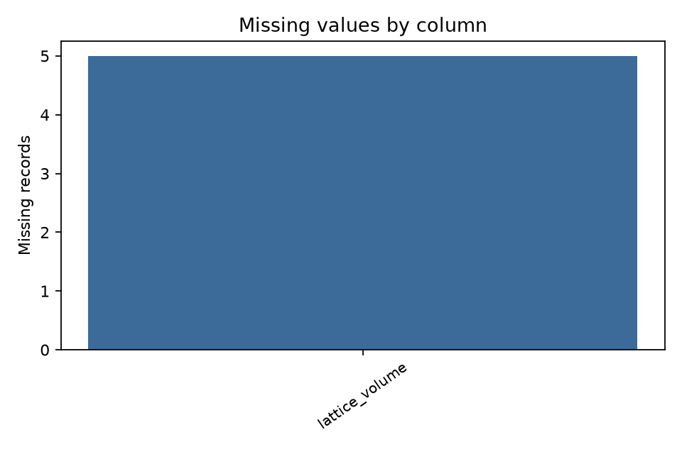
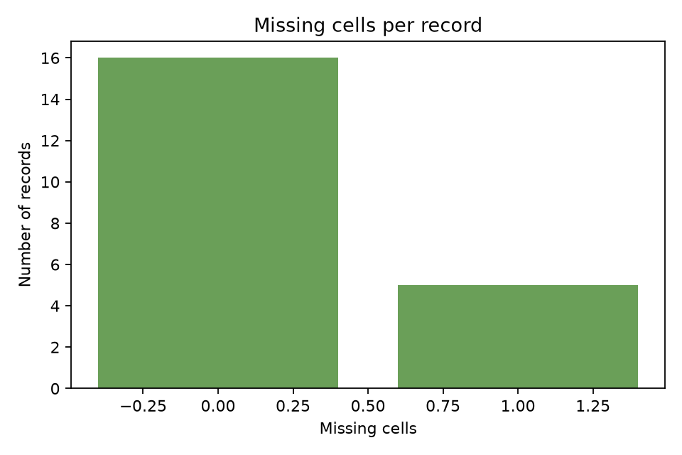
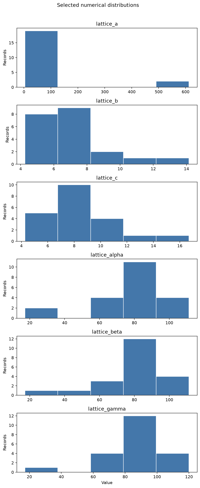
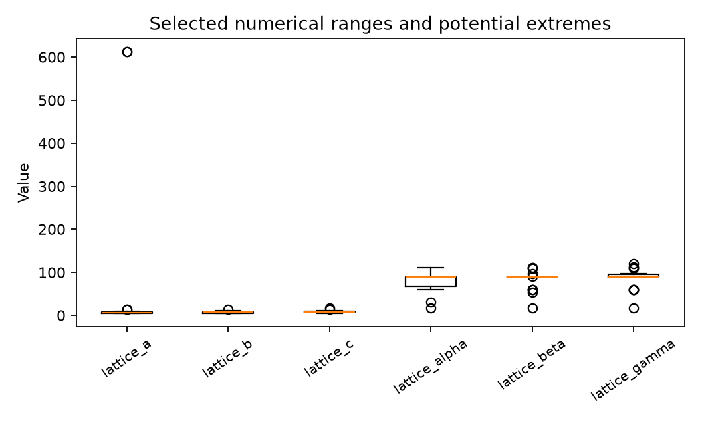
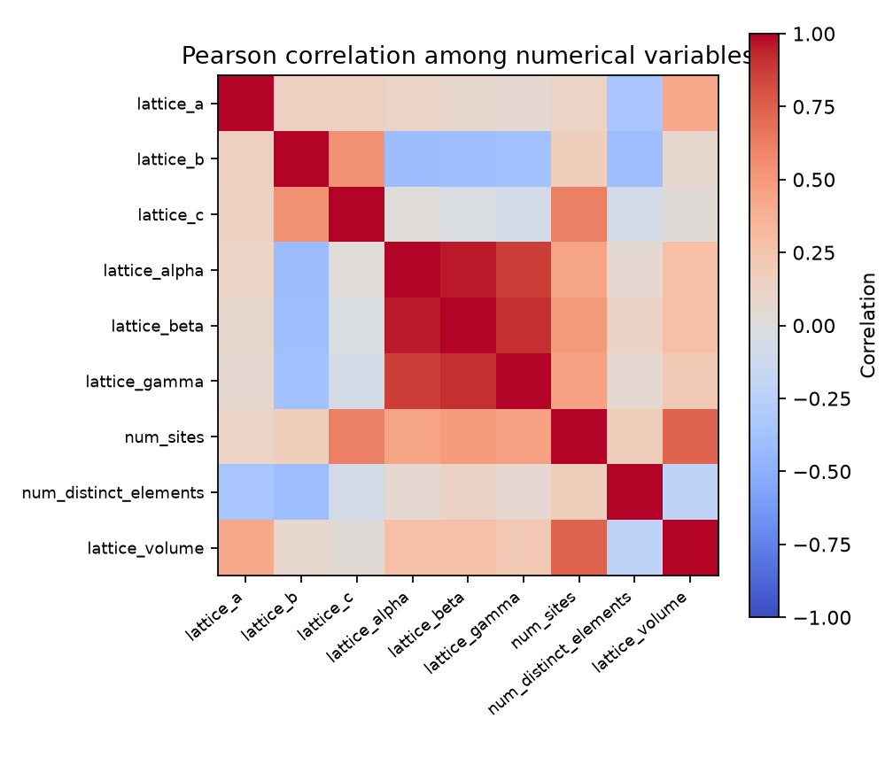

# Data Inspection Report

*Researcher-centric investigation of structures_with_issues.json*

## Overview

This JSON dataset contains **21 records** across **11 variables** (2 integer, 1 mixed, 6 number, 2 string). It uses 7,434 bytes (7.2598 KiB) on disk and about 20,405 bytes (19.927 KiB) in the profiled DataFrame.

| First-page summary | Evidence |
| --- | --- |
| Overall completeness | 97.835% (5 missing cells across 1 variables) |
| Exact duplicate records | 1 additional occurrence(s) beyond the first |
| Identifier-like variables | 1 |
| Review findings | 11 |

| Metric | Value |
| --- | --- |
| Source file | structures_with_issues.json |
| Source path | data/demo/structures_with_issues.json |
| Extension | .json |
| Format | JSON |
| File size | 7,434 bytes (7.2598 KiB) |
| Rows | 21 |
| Columns | 11 |
| Estimated in-memory size | 20,405 bytes (19.927 KiB) |

### Priority observations

- **Duplicate rows**: 1 repeated row(s) beyond the first occurrence.
- **High missingness** in **lattice_volume**: 5 missing of 21 values (23.81%).
- **Mixed value types** in **lattice_volume**: Observed number: 15, string: 1. Representative unexpected values: \['not measured'\].
- **Potential numerical outliers** in **lattice_a**: 4/21 finite numeric values outside IQR fences \[0.674231, 11.6106\]. Examples: 13.4622, 14.1533, 612.67.
- **Potential numerical outliers** in **lattice_alpha**: 2/21 finite numeric values outside IQR fences \[33.6311, 123.821\]. Examples: 30.3091, 17.2597.

Initial assessment: the source was profiled without changing values. These are investigation prompts, not automatic corrections or scientific validation.

## Overall summary

- Missing cells: 5 across 1 column(s).
- Additional duplicate rows: 1.
- Potential quality findings: 11.

## Schema inventory

### Chapter 1: Understanding what is in the dataset

The schema comprises 2 integer, 1 mixed, 6 number, 2 string. 1 variable(s) are identifier-like and are not interpreted as measurements.

| Column | Non-null | Inferred semantic type | Observed types (count) | Likely identifier |
| --- | --- | --- | --- | --- |
| material_id | 21 | string | string: 21 | Yes |
| lattice_a | 21 | number | number: 21 | No |
| lattice_b | 21 | number | number: 21 | No |
| lattice_c | 21 | number | number: 21 | No |
| lattice_alpha | 21 | number | number: 21 | No |
| lattice_beta | 21 | number | number: 21 | No |
| lattice_gamma | 21 | number | number: 21 | No |
| num_sites | 21 | integer | integer: 21 | No |
| num_distinct_elements | 21 | integer | integer: 21 | No |
| elements | 21 | string | string: 21 | No |
| lattice_volume | 16 | mixed | number: 15, string: 1 | No |

| Variable | Type | Non-null | Distinct | Note |
| --- | --- | --- | --- | --- |
| material_id | string | 21 | 20 | Identifier-like |
| lattice_a | number | 21 | 20 |  |
| lattice_b | number | 21 | 20 |  |
| lattice_c | number | 21 | 20 |  |
| lattice_alpha | number | 21 | 12 |  |
| lattice_beta | number | 21 | 11 |  |
| lattice_gamma | number | 21 | 13 |  |
| num_sites | integer | 21 | 15 |  |
| num_distinct_elements | integer | 21 | 3 |  |
| elements | string | 21 | 20 |  |
| lattice_volume | mixed | 16 | 15 |  |

## Missing values

### Chapter 2: Can I rely on the completeness of this data?

Overall completeness is **97.835%**. Missingness affects 1 variable(s).

Most affected variables: **lattice_volume** 5 (23.81%).

| Column | Missing | Missing % | Non-null | High missingness |
| --- | --- | --- | --- | --- |
| material_id | 0 | 0% | 21 | No |
| lattice_a | 0 | 0% | 21 | No |
| lattice_b | 0 | 0% | 21 | No |
| lattice_c | 0 | 0% | 21 | No |
| lattice_alpha | 0 | 0% | 21 | No |
| lattice_beta | 0 | 0% | 21 | No |
| lattice_gamma | 0 | 0% | 21 | No |
| num_sites | 0 | 0% | 21 | No |
| num_distinct_elements | 0 | 0% | 21 | No |
| elements | 0 | 0% | 21 | No |
| lattice_volume | 5 | 23.81% | 16 | Yes |

*Columns ranked by the number of missing records.*

*Distribution of missing-cell burden across records.*

## Duplicate rows

The count is additional full-row occurrences beyond the first occurrence in each group after missing-value normalization.

| Metric | Value |
| --- | --- |
| Additional duplicate rows | 1 |
| Share of all rows | 4.7619% |

## Numeric summaries

### Chapter 3: What do the measurements tell us?

- **lattice_a**: range 3.8746 to 612.67, median 6.3148, skewness 2.9734.
- **lattice_beta**: range 17.26 to 111.29, median 90, skewness -1.53.
- **lattice_gamma**: range 17.26 to 120, median 90, skewness -1.3246.
- **lattice_alpha**: range 17.26 to 111.29, median 90, skewness -1.2855.
- **lattice_c**: range 4.2742 to 16.694, median 8.1084, skewness 1.2532.

*Histograms for selected numerical measurements; interpret scales separately.*

*Selected numerical ranges; points beyond whiskers are distributional candidates, not errors.*

| Column | Finite count | Nonfinite excluded | Minimum | Maximum | Mean | Median | Sample std (ddof=1) | Q1 (25%) | Q3 (75%) | Scope / notes |
| --- | --- | --- | --- | --- | --- | --- | --- | --- | --- | --- |
| lattice_a | 21 | 0 | 3.8746 | 612.67 | 64.369 | 6.3148 | 182.31 | 4.7754 | 7.5094 | Finite numeric values |
| lattice_b | 21 | 0 | 4.2646 | 14.153 | 7.0575 | 7.0268 | 2.4682 | 5.1092 | 8.0789 | Finite numeric values |
| lattice_c | 21 | 0 | 4.2742 | 16.694 | 8.3336 | 8.1084 | 2.9454 | 6.9357 | 9.4301 | Finite numeric values |
| lattice_alpha | 21 | 0 | 17.26 | 111.29 | 81.083 | 90 | 24.305 | 67.452 | 90 | Finite numeric values |
| lattice_beta | 21 | 0 | 17.26 | 111.29 | 83.842 | 90 | 22.128 | 90 | 90 | Finite numeric values |
| lattice_gamma | 21 | 0 | 17.26 | 120 | 85.744 | 90 | 23.229 | 90 | 94.927 | Finite numeric values |
| num_sites | 21 | 0 | 3 | 56 | 19.333 | 20 | 13.496 | 8 | 25 | Finite numeric values |
| num_distinct_elements | 21 | 0 | 2 | 4 | 2.6667 | 3 | 0.65828 | 2 | 3 | Finite numeric values |
| lattice_volume | 15 | 0 | 128.13 | 669.01 | 323.62 | 275.28 | 143.58 | 219.24 | 424.51 | Finite numeric values |

## Categorical summaries

### Chapter 4: Are the categorical variables consistent?

- **elements**: 20 distinct values; most common is "Li, P" (2/21).
- **lattice_volume**: 15 distinct values; most common is 470.82 (2/16).

| Column | Distinct (non-missing) | Most frequent value | Frequency (non-missing) | Top values (count) | Notes |
| --- | --- | --- | --- | --- | --- |
| material_id | 20 | N/A | N/A | N/A | Likely identifier; mode and top values suppressed |
| elements | 20 | "Li, P" | 2 / 21 (9.5238%) | "Li, P" (2); "C, F, O" (1); "Nd, O, Te" (1); "Al, B, O" (1); "Bi, Co, Zr" (1) |  |
| lattice_volume | 15 | 470.82 | 2 / 16 (12.5%) | 470.82 (2); "not measured" (1); 298.11 (1); 297.48 (1); 669.01 (1) |  |

### Chapter 5: How do variables relate to one another?

- **lattice_alpha** and **lattice_beta**: Pearson 0.95449, Spearman 0.88182 across 21 complete pairs.
- **lattice_beta** and **lattice_gamma**: Pearson 0.91366, Spearman 0.83121 across 21 complete pairs.
- **num_sites** and **lattice_volume**: Pearson 0.73184, Spearman 0.87332 across 15 complete pairs.
- **lattice_alpha** and **lattice_gamma**: Pearson 0.86381, Spearman 0.76504 across 21 complete pairs.
- **lattice_a** and **lattice_b**: Pearson 0.14603, Spearman 0.64522 across 21 complete pairs.

*Pearson correlations among selected numerical variables; association is not causation.*

## Data quality findings

### Chapter 6: What should concern the researcher?

### Duplicate rows

**Detected:** 1 repeated row(s) beyond the first occurrence.

**Rule:** Full-row equality after missing-value normalization; count additional occurrences only.

**Why investigate:** Check whether repeated records are intended replicates before removing anything.

### High missingness — lattice_volume

**Detected:** 5 missing of 21 values (23.81%).

**Rule:** High missingness when missing fraction &gt;= 5.0%; any missing values are reported.

**Why investigate:** Review collection coverage before relying on this column; no imputation has been performed.

### Mixed value types — lattice_volume

**Detected:** Observed number: 15, string: 1. Representative unexpected values: \['not measured'\].

**Rule:** Incompatible JSON native types, or CSV numeric proportion &gt;= 80% with nonnumeric tokens; boolean/number mixtures are incompatible.

**Why investigate:** Review unexpected values or inconsistent encoding. Mixed codes can be intentional, not confirmed errors.

### Potential numerical outliers — lattice_a

**Detected:** 4/21 finite numeric values outside IQR fences \[0.674231, 11.6106\]. Examples: 13.4622, 14.1533, 612.67.

**Rule:** x &lt; Q1 - 1.5 × IQR or x &gt; Q3 + 1.5 × IQR; linear quartiles, strict inequalities.

**Why investigate:** Potential outliers are not confirmed errors. Skewed or multimodal distributions may naturally produce them.

### Potential numerical outliers — lattice_alpha

**Detected:** 2/21 finite numeric values outside IQR fences \[33.6311, 123.821\]. Examples: 30.3091, 17.2597.

**Rule:** x &lt; Q1 - 1.5 × IQR or x &gt; Q3 + 1.5 × IQR; linear quartiles, strict inequalities.

**Why investigate:** Potential outliers are not confirmed errors. Skewed or multimodal distributions may naturally produce them.

### Potential numerical outliers — lattice_b

**Detected:** 1/21 finite numeric values outside IQR fences \[0.654785, 12.5333\]. Examples: 14.1533.

**Rule:** x &lt; Q1 - 1.5 × IQR or x &gt; Q3 + 1.5 × IQR; linear quartiles, strict inequalities.

**Why investigate:** Potential outliers are not confirmed errors. Skewed or multimodal distributions may naturally produce them.

### Potential numerical outliers — lattice_c

**Detected:** 2/21 finite numeric values outside IQR fences \[3.19415, 13.1717\]. Examples: 16.6939, 14.1533.

**Rule:** x &lt; Q1 - 1.5 × IQR or x &gt; Q3 + 1.5 × IQR; linear quartiles, strict inequalities.

**Why investigate:** Potential outliers are not confirmed errors. Skewed or multimodal distributions may naturally produce them.

### Potential numerical outliers — lattice_gamma

**Detected:** 9/21 finite numeric values outside IQR fences \[82.6092, 102.318\]. Examples: 110.754, 60, 60, 60, 109.471.

**Rule:** x &lt; Q1 - 1.5 × IQR or x &gt; Q3 + 1.5 × IQR; linear quartiles, strict inequalities.

**Why investigate:** Potential outliers are not confirmed errors. Skewed or multimodal distributions may naturally produce them.

### Potential numerical outliers — num_sites

**Detected:** 1/21 finite numeric values outside IQR fences \[-17.5, 50.5\]. Examples: 56.

**Rule:** x &lt; Q1 - 1.5 × IQR or x &gt; Q3 + 1.5 × IQR; linear quartiles, strict inequalities.

**Why investigate:** Potential outliers are not confirmed errors. Skewed or multimodal distributions may naturally produce them.

### Strong numerical correlation — lattice_alpha ↔ lattice_beta

**Detected:** Pearson=0.954, Spearman=0.882, based on 21 complete pair(s).

**Rule:** Absolute Pearson or Spearman correlation &gt;= 0.90.

**Why investigate:** The variables may be redundant or related; correlation does not establish causation.

### Strong numerical correlation — lattice_beta ↔ lattice_gamma

**Detected:** Pearson=0.914, Spearman=0.831, based on 21 complete pair(s).

**Rule:** Absolute Pearson or Spearman correlation &gt;= 0.90.

**Why investigate:** The variables may be redundant or related; correlation does not establish causation.

| Check name | Column | Severity | Evidence | Rule | Explanation |
| --- | --- | --- | --- | --- | --- |
| Duplicate rows | (whole dataset) | warning | 1 repeated row(s) beyond the first occurrence. | Full-row equality after missing-value normalization; count additional occurrences only. | Check whether repeated records are intended replicates before removing anything. |
| High missingness | lattice_volume | warning | 5 missing of 21 values (23.81%). | High missingness when missing fraction &gt;= 5.0%; any missing values are reported. | Review collection coverage before relying on this column; no imputation has been performed. |
| Mixed value types | lattice_volume | warning | Observed number: 15, string: 1. Representative unexpected values: \['not measured'\]. | Incompatible JSON native types, or CSV numeric proportion &gt;= 80% with nonnumeric tokens; boolean/number mixtures are incompatible. | Review unexpected values or inconsistent encoding. Mixed codes can be intentional, not confirmed errors. |
| Potential numerical outliers | lattice_a | info | 4/21 finite numeric values outside IQR fences \[0.674231, 11.6106\]. Examples: 13.4622, 14.1533, 612.67. | x &lt; Q1 - 1.5 × IQR or x &gt; Q3 + 1.5 × IQR; linear quartiles, strict inequalities. | Potential outliers are not confirmed errors. Skewed or multimodal distributions may naturally produce them. |
| Potential numerical outliers | lattice_alpha | info | 2/21 finite numeric values outside IQR fences \[33.6311, 123.821\]. Examples: 30.3091, 17.2597. | x &lt; Q1 - 1.5 × IQR or x &gt; Q3 + 1.5 × IQR; linear quartiles, strict inequalities. | Potential outliers are not confirmed errors. Skewed or multimodal distributions may naturally produce them. |
| Potential numerical outliers | lattice_b | info | 1/21 finite numeric values outside IQR fences \[0.654785, 12.5333\]. Examples: 14.1533. | x &lt; Q1 - 1.5 × IQR or x &gt; Q3 + 1.5 × IQR; linear quartiles, strict inequalities. | Potential outliers are not confirmed errors. Skewed or multimodal distributions may naturally produce them. |
| Potential numerical outliers | lattice_c | info | 2/21 finite numeric values outside IQR fences \[3.19415, 13.1717\]. Examples: 16.6939, 14.1533. | x &lt; Q1 - 1.5 × IQR or x &gt; Q3 + 1.5 × IQR; linear quartiles, strict inequalities. | Potential outliers are not confirmed errors. Skewed or multimodal distributions may naturally produce them. |
| Potential numerical outliers | lattice_gamma | info | 9/21 finite numeric values outside IQR fences \[82.6092, 102.318\]. Examples: 110.754, 60, 60, 60, 109.471. | x &lt; Q1 - 1.5 × IQR or x &gt; Q3 + 1.5 × IQR; linear quartiles, strict inequalities. | Potential outliers are not confirmed errors. Skewed or multimodal distributions may naturally produce them. |
| Potential numerical outliers | num_sites | info | 1/21 finite numeric values outside IQR fences \[-17.5, 50.5\]. Examples: 56. | x &lt; Q1 - 1.5 × IQR or x &gt; Q3 + 1.5 × IQR; linear quartiles, strict inequalities. | Potential outliers are not confirmed errors. Skewed or multimodal distributions may naturally produce them. |
| Strong numerical correlation | lattice_alpha ↔ lattice_beta | info | Pearson=0.954, Spearman=0.882, based on 21 complete pair(s). | Absolute Pearson or Spearman correlation &gt;= 0.90. | The variables may be redundant or related; correlation does not establish causation. |
| Strong numerical correlation | lattice_beta ↔ lattice_gamma | info | Pearson=0.914, Spearman=0.831, based on 21 complete pair(s). | Absolute Pearson or Spearman correlation &gt;= 0.90. | The variables may be redundant or related; correlation does not establish causation. |

### Chapter 7: Recommended next investigations

- Trace missing fields to collection or export steps before selecting a treatment; distinguish unavailable measurements from not-applicable values.
- Review extreme observations and zeros against source records and units; decide whether they are valid measurements, censoring, or coding conventions.
- Inspect raw categorical labels before grouping them, and preserve an auditable normalization map if one is justified.
- Check repeated records and strongly aligned variables against the study design before removing rows or selecting predictors.

## Rules and limitations

### Chapter 8: Methodology and limitations

Missing strings are normalized using configured trimmed, case-insensitive markers; JSON null and absent keys are missing. Numerical summaries use finite float64 values, linear quartiles and sample standard deviation. IQR alerts use strict fences; Pearson and Spearman associations use complete pairs. The tool processes the full file in memory.

Statistical observations are not errors by themselves. This tool does not validate units, study design, causality, scientific plausibility, nested JSON or JSON Lines.

### Technical appendix

#### Complete schema inventory

| Variable | Type | Non-null | Distinct | Observed values | Identifier-like |
| --- | --- | --- | --- | --- | --- |
| material_id | string | 21 | 20 | string: 21 | Yes |
| lattice_a | number | 21 | 20 | number: 21 | No |
| lattice_b | number | 21 | 20 | number: 21 | No |
| lattice_c | number | 21 | 20 | number: 21 | No |
| lattice_alpha | number | 21 | 12 | number: 21 | No |
| lattice_beta | number | 21 | 11 | number: 21 | No |
| lattice_gamma | number | 21 | 13 | number: 21 | No |
| num_sites | integer | 21 | 15 | integer: 21 | No |
| num_distinct_elements | integer | 21 | 3 | integer: 21 | No |
| elements | string | 21 | 20 | string: 21 | No |
| lattice_volume | mixed | 16 | 15 | number: 15, string: 1 | No |

#### Numerical statistics appendix

| Variable | Finite | Min | Max | Mean | Median | Std | Variance | Q1 | Q3 | Skew | Kurtosis | Zeros |
| --- | --- | --- | --- | --- | --- | --- | --- | --- | --- | --- | --- | --- |
| lattice_a | 21 | 3.8746 | 612.67 | 64.369 | 6.3148 | 182.31 | 33235 | 4.7754 | 7.5094 | 2.9734 | 7.5576 | 0 (0%) |
| lattice_b | 21 | 4.2646 | 14.153 | 7.0575 | 7.0268 | 2.4682 | 6.0919 | 5.1092 | 8.0789 | 1.2395 | 2.1914 | 0 (0%) |
| lattice_c | 21 | 4.2742 | 16.694 | 8.3336 | 8.1084 | 2.9454 | 8.6752 | 6.9357 | 9.4301 | 1.2532 | 2.6458 | 0 (0%) |
| lattice_alpha | 21 | 17.26 | 111.29 | 81.083 | 90 | 24.305 | 590.72 | 67.452 | 90 | -1.2855 | 1.5717 | 0 (0%) |
| lattice_beta | 21 | 17.26 | 111.29 | 83.842 | 90 | 22.128 | 489.66 | 90 | 90 | -1.53 | 2.9634 | 0 (0%) |
| lattice_gamma | 21 | 17.26 | 120 | 85.744 | 90 | 23.229 | 539.59 | 90 | 94.927 | -1.3246 | 2.6054 | 0 (0%) |
| num_sites | 21 | 3 | 56 | 19.333 | 20 | 13.496 | 182.13 | 8 | 25 | 0.89692 | 1.095 | 0 (0%) |
| num_distinct_elements | 21 | 2 | 4 | 2.6667 | 3 | 0.65828 | 0.43333 | 2 | 3 | 0.47357 | -0.55123 | 0 (0%) |
| lattice_volume | 15 | 128.13 | 669.01 | 323.62 | 275.28 | 143.58 | 20616 | 219.24 | 424.51 | 1.0874 | 0.86054 | 0 (0%) |

#### Detailed quality evidence

| Check | Location | Severity | Evidence | Rule |
| --- | --- | --- | --- | --- |
| Duplicate rows | Dataset | warning | 1 repeated row(s) beyond the first occurrence. | Full-row equality after missing-value normalization; count additional occurrences only. |
| High missingness | lattice_volume | warning | 5 missing of 21 values (23.81%). | High missingness when missing fraction &gt;= 5.0%; any missing values are reported. |
| Mixed value types | lattice_volume | warning | Observed number: 15, string: 1. Representative unexpected values: \['not measured'\]. | Incompatible JSON native types, or CSV numeric proportion &gt;= 80% with nonnumeric tokens; boolean/number mixtures are incompatible. |
| Potential numerical outliers | lattice_a | info | 4/21 finite numeric values outside IQR fences \[0.674231, 11.6106\]. Examples: 13.4622, 14.1533, 612.67. | x &lt; Q1 - 1.5 × IQR or x &gt; Q3 + 1.5 × IQR; linear quartiles, strict inequalities. |
| Potential numerical outliers | lattice_alpha | info | 2/21 finite numeric values outside IQR fences \[33.6311, 123.821\]. Examples: 30.3091, 17.2597. | x &lt; Q1 - 1.5 × IQR or x &gt; Q3 + 1.5 × IQR; linear quartiles, strict inequalities. |
| Potential numerical outliers | lattice_b | info | 1/21 finite numeric values outside IQR fences \[0.654785, 12.5333\]. Examples: 14.1533. | x &lt; Q1 - 1.5 × IQR or x &gt; Q3 + 1.5 × IQR; linear quartiles, strict inequalities. |
| Potential numerical outliers | lattice_c | info | 2/21 finite numeric values outside IQR fences \[3.19415, 13.1717\]. Examples: 16.6939, 14.1533. | x &lt; Q1 - 1.5 × IQR or x &gt; Q3 + 1.5 × IQR; linear quartiles, strict inequalities. |
| Potential numerical outliers | lattice_gamma | info | 9/21 finite numeric values outside IQR fences \[82.6092, 102.318\]. Examples: 110.754, 60, 60, 60, 109.471. | x &lt; Q1 - 1.5 × IQR or x &gt; Q3 + 1.5 × IQR; linear quartiles, strict inequalities. |
| Potential numerical outliers | num_sites | info | 1/21 finite numeric values outside IQR fences \[-17.5, 50.5\]. Examples: 56. | x &lt; Q1 - 1.5 × IQR or x &gt; Q3 + 1.5 × IQR; linear quartiles, strict inequalities. |
| Strong numerical correlation | lattice_alpha ↔ lattice_beta | info | Pearson=0.954, Spearman=0.882, based on 21 complete pair(s). | Absolute Pearson or Spearman correlation &gt;= 0.90. |
| Strong numerical correlation | lattice_beta ↔ lattice_gamma | info | Pearson=0.914, Spearman=0.831, based on 21 complete pair(s). | Absolute Pearson or Spearman correlation &gt;= 0.90. |
